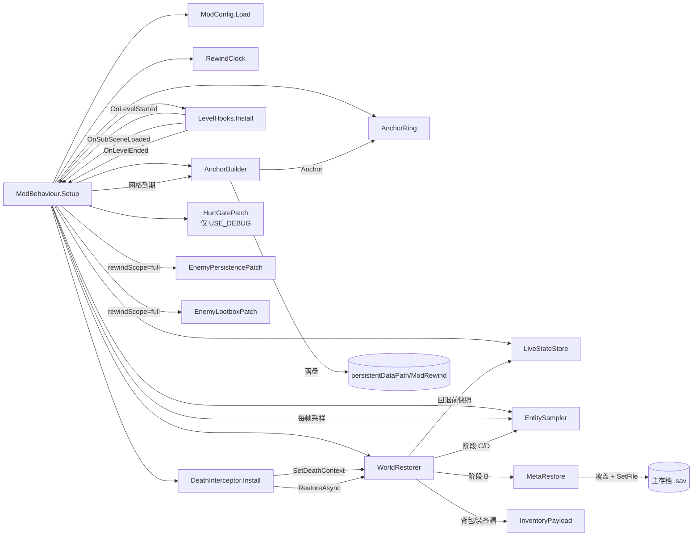
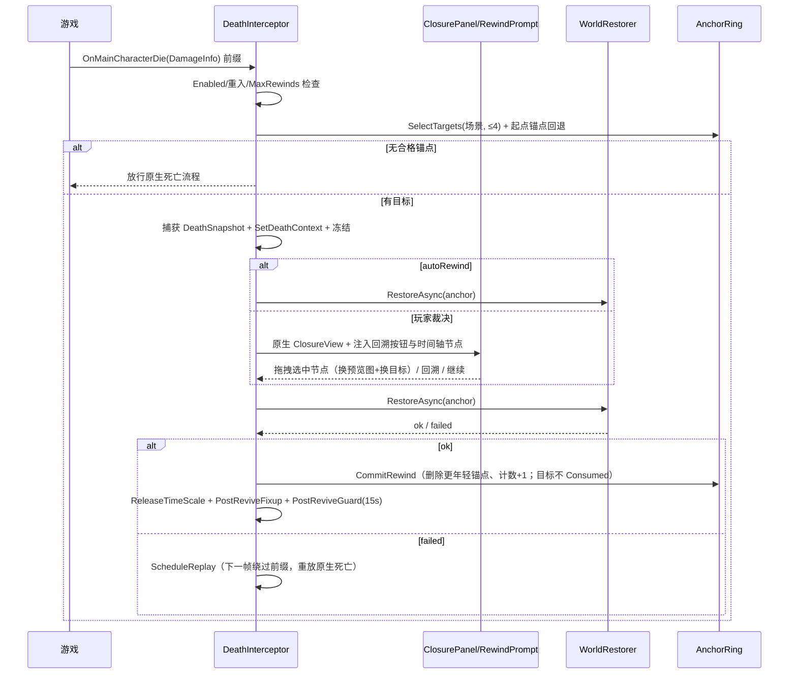

# Death Rewind 代码地图

- 适用代码：`src/DeathRewind`（当前工作区）
- 目标游戏：《逃离鸭科夫》/ Escape from Duckov（Unity Mono + 原生 Mod 加载 + Harmony 2.x）
- 目标框架：`net472`，程序集名 `DeathRewind`，入口类型 `DeathRewind.ModBehaviour`

本文是代码结构索引，不替代设计规格（`docs/superpowers/specs/`）与验证计划（`docs/superpowers/plans/`）。

---

## 1. 目录与单元清单

```text
src/DeathRewind/
├── ModBehaviour.cs           Mod 入口与总装配
├── ModLog.cs                 诊断日志统一开关
├── ModConfigBridge.cs        ModConfig 工坊框架反射桥接
├── Core/                     纯 C# 逻辑（禁止引用 Unity / 游戏程序集）
│   ├── AnchorRing.cs
│   ├── RewindClock.cs
│   ├── LiveStateStore.cs
│   ├── Dto.cs
│   ├── RewindCandidate.cs
│   ├── TimelineLayout.cs
│   └── DeathPanelLayout.cs
├── Unity/                    Unity / 游戏 API 适配层
│   ├── LevelHooks.cs
│   ├── LevelAccess.cs
│   ├── EntitySampler.cs
│   ├── AnchorBuilder.cs
│   ├── AnchorBuildContext.cs
│   ├── WorldRestorer.cs
│   ├── MetaRestore.cs
│   ├── InventoryPayload.cs
│   └── ThumbnailCapture.cs
├── Harmony/                  Harmony 补丁
│   ├── DeathInterceptor.cs
│   ├── EnemyPersistencePatch.cs
│   ├── EnemyLootboxPatch.cs
│   ├── HurtGatePatch.cs
│   └── HarmonyGuard.cs
├── UI/
│   ├── ClosurePanel.cs       原生 YOU DIED 界面注入
│   ├── RewindIndicator.cs    HUD「1up」机会指示
│   └── RewindPrompt.cs       IMGUI 降级裁决面板
├── Config/ModConfig.cs       config.txt + 游戏内设置
└── Compat/PrivateStateAccessor.cs  私有字段反射访问
```

| 单元 | 职责 | 关键 API |
|---|---|---|
| `ModBehaviour` | Mod 入口；装配全部单元；每帧驱动时钟、采样、锚点构建；处理关卡生命周期、调试热键、IMGUI、时间缩放所有权 | `Ring`、`CurrentTick`、`FreezeTimeScale`、`ReleaseTimeScale`、`ReleaseAnchor`、`ReleaseCommittedDestroy`、`GetLevelStartAnchor` |
| `ModLog` | Info/Warning 诊断日志统一出口；`USE_DEBUG=false` 时静默，Error 始终输出 | `USE_DEBUG`、`Log`、`LogWarning` |
| `ModConfigBridge` | 通过反射接入 ModConfig 工坊框架；缺失时静默降级回 config.txt | `Available`、`AddDropdown`、`AddSlider`、`AddBool`、`AddOptionsChanged`、`Load`、`Prefixed` |
| `RewindClock` | 有效 tick（冻结期间不计时）、冻结/恢复 | `Tick`、`Freeze`、`Resume`、`IsFrozen`、`CurrentTick` |
| `AnchorRing` | 网格时间线、Id 分配、入环/淘汰、目标选择（单个/候选列表）、按场景移除、回退计数；纯逻辑 | `PollDueGridTimestamp`、`AllocateId`、`Insert`、`SelectTarget`、`SelectTargets`、`CanRewind`、`CommitRewind`、`RemoveByScene`、`ResetGridTo`、`Clear` |
| `LiveStateStore` | 实体键 → DTO 的实时状态字典；提供锚点快照/整体替换 | `ReplaceFrom`、`Clear` |
| `Dto` | 纯 C# 数据模型与 `Anchor` 定义 | `PlayerState`、`EnemyState`、`ContainerState`、`DoorState`、`WorldState`、`DeathSnapshot`、`PreRewindSnapshot`、`Anchor` |
| `DeathPanelLayout` | 纯函数的回溯控件布局计算 | `RectF`、`DeathPanelLayout.Result` |
| `TimelineLayout` | 纯函数的时间轴几何（横条、节点、标签、拖拽吸附） | `Compute`、`NearestNode`、`TimelineLayout.Result` |
| `RewindCandidate` | 结算界面的一个回溯候选节点（锚点 + 回溯年龄 + 缩略图） | `RewindCandidate` |
| `LevelHooks` | 订阅关卡/子场景/场景卸载/局结束事件并归一化为三个回调（子场景回调带场景名） | `OnLevelStarted`、`OnSubSceneLoaded(string)`、`OnLevelEnded` |
| `LevelAccess` | 安全读取游戏静态状态（主角色、相机、容器表、场景键、加载态） | `MainCharacter`、`MainCamera`、`LootBoxInventories`、`CurrentSceneKey`、`LevelReady`、`MultiSceneLoading` |
| `EntitySampler` | 定期采样玩家/敌人/容器/门；维护敌人稳定 Id 与死亡敌人登记；锚点覆盖关系 | `Sample`、`RegisterDeadEnemy`、`GetEnemyHealth`、`GetEnemyObject`、`ReleaseAnchor`、`SetAnchorCoverage`、`ResetRegistry`、`RefreshRegistry` |
| `AnchorBuilder` | 分帧构建锚点：采集 → 后台 IO 落盘 → 完成校验 | `BeginBuild`、`ContinueCapture`、`StartIo`、`IsIoCompleted`、`CompleteBuild`、`DeleteAllAnchorFiles`、`CleanupOrphanFiles` |
| `AnchorBuildContext` | 单次锚点构建的分帧采集/异步 IO 状态载体 | `Anchor`、`CaptureDone`、`IoTask` 等 |
| `WorldRestorer` | 执行差量恢复阶段 A–F，失败时反向补偿 | `RestoreAsync`、`SetDeathContext`、`PhaseA/B/C/D/E/E2/E3/E4/E6/F` |
| `MetaRestore` | 主存档原子覆盖 + `SavesSystem.SetFile` 触发元系统重载；回退前备份 | `OverwriteFrom`、`BackupCurrent` |
| `InventoryPayload` | 背包与装备槽载荷的采集/解析/原地还原 | `Capture`、`Parse`、`ApplyAsync`、`CaptureItem`、`InstantiateItemAsync`、`CaptureSlots`、`ApplySlotsAsync`、`VerifyRoundTrip` |
| `ThumbnailCapture` | 锚点构建同帧抓屏 → 缩放 → PNG | `Capture` |
| `DeathInterceptor` | 死亡入口前缀拦截、裁决流程、恢复编排与复活后守卫 | `Install`、`OnDeathPrefix`、`DeathChoiceRoutine`、`RestoreRoutine`、`PostReviveFixup`、`PostReviveGuard`、`AcceptDeath`、`ScheduleReplay` |
| `EnemyPersistencePatch` | 阻止死亡敌人 `Health.DestroyOnDelay` 销毁 | `Health.DestroyOnDelay` 前缀 |
| `EnemyLootboxPatch` | 阻止敌人死亡时装备被搬进尸体箱 | `InteractableLootbox.CreateFromItem` 前缀 |
| `HurtGatePatch` | 调试期伤害门控诊断（记录伤害被吞/无敌调用栈），仅 `USE_DEBUG` 时安装 | `Health.Hurt` 后缀、`Health.SetInvincible` 前缀 |
| `HarmonyGuard` | 补丁注册前 Harmony 版本/冲突检测（接受 2.x） | `CanRegister` |
| `ClosurePanel` | 在原生 YOU DIED 界面注入回溯按钮、提示文字、箭头、预览图与可拖拽时间轴 | `Create`、`SetRewindLabel`、`SelectedIndex`、`CandidateCount`、`NodeSelected`、`Layout`、`Dispose` |
| `RewindIndicator` | HUD Buffs 状态栏首位的「1up」硬币指示 | `SetAvailable`、`Dispose` |
| `RewindPrompt` | 原生结算界面不可用时的 IMGUI 降级面板 | `Open`、`Close`、`Draw` |
| `ModConfig` | config.txt 解析/校验 + 游戏内设置覆盖 + 调试开关 | `Load`、`Validate`、`FilePath` |
| `PrivateStateAccessor` | 集中反射读写游戏私有字段，失败时降级 | `GetBool`、`SetBool`、`GetFloat`、`SetFloat`、`GetObject` |

---

## 2. 运行时装配



初始化顺序（`ModBehaviour.Setup`）：

1. 读取 `ModConfig`（config.txt → 游戏内设置覆盖 → 校验回落）。
2. 构造 `RewindClock / AnchorRing / LiveStateStore / EntitySampler / AnchorBuilder / WorldRestorer`。
3. 安装 `LevelHooks` 并订阅三个事件。
4. 安装 `DeathInterceptor`（失败则 Mod 降级为不拦截）。
5. `USE_DEBUG=true` 时安装 `HurtGatePatch` 诊断补丁。
6. `rewindScope=full` 时安装敌人持久化与战利品箱补丁；`position` 模式不装。

---

## 3. 主循环与锚点生命周期

每帧 `ModBehaviour.Update`：

1. `_clock.Tick(Time.unscaledTime)`：冻结期间有效 tick 不前进；`_ring.SetTick`。
2. 未冻结时按 `sampleInterval`（默认 0.25s）调用 `EntitySampler.Sample`。
3. `AnchorRing.PollDueGridTimestamp` 跨过网格边界时，满足以下条件才 `BeginBuild`：
   - `LevelAccess.LevelReady`；
   - 已过场景静置窗口（场景切换后 0.75s、`MultiSceneLoading` 结束后 0.35s）；
   - 当前场景 == `_mapSceneKey`（只在地图游玩场景建锚点）。
4. 场景内尚无起点锚点时，静置后补建一个“进入场景那一刻”的锚点。
5. 构建分帧推进：`ContinueCapture`（受 `anchorCaptureBatchSize` / `anchorCaptureBudgetMs` 限制）→ `StartIo`（后台线程）→ `IsIoCompleted` → `CompleteBuild` → `AnchorRing.Insert`。
6. 淘汰锚点 → `EntitySampler.ReleaseAnchor`；刷新锚点覆盖关系；每场景第一个锚点记为起点锚点。
7. `RewindIndicator.SetAvailable(_ring.RewindCount < MaxRewinds)`。
8. `HandleDebugHotkeys`（仅 debugMode）。

关卡生命周期（`LevelHooks`）：

| 事件源 | 处理 |
|---|---|
| `LevelManager.OnLevelInitialized` | 清空锚点环/实时状态/敌人注册表；重置网格原点；记录 `_mapSceneKey`；进入 0.75s 静置窗口 |
| `MultiSceneCore.OnSubSceneLoaded` | `RefreshRegistry` + 丢弃该场景的旧锚点与起点锚点（同名子场景重进 = 全新实例，旧坐标失效）；**不清整个锚点环、不重置回退计数**（地道/楼层） |
| `SceneManager.sceneUnloaded` | 卸载的是已登记子场景则忽略；否则视为关卡结束 |
| `RaidUtilities.OnRaidEnd` | 关卡/局结束 → 清理锚点与落盘文件（保留 `save_backup.sav`） |

> 关键判定：`_mapSceneKey` 是 `level started` 时激活的场景（如 `Level_Farm_01`），不是 `MultiSceneCore.MainScene`（壳场景 `Level_Farm_Main` 不在该场景建锚点）。

---

## 4. 死亡 → 裁决 → 回溯



关键点：

- **目标选择**：当前场景内年龄 ≥ `minRewindAge` 的最新未消耗锚点；没有则回退到起点锚点（年龄需 ≥ 2s，刚进图就死视为无锚点）。
- **跨地图保护**：锚点 `SceneKey` 与当前场景不一致 → 放弃回溯，放行原生死亡。
- **接受死亡**：设置 `_bypassNext`，下一帧重放 `LevelManager.OnMainCharacterDie`，并用 `_suppressNextClosure` 跳过一次重复结算界面。
- **复活后守卫**：15s 内每 0.5s 复检 `invincible` / `isDead` / `MultiSceneCore.IsLoading` / `mainDamageReceiver`，发现外部来源翻回即复位。

---

## 5. 恢复阶段

`WorldRestorer.RestoreAsync(anchor)`：

| 阶段 | 内容 | 失败处理 |
|---|---|---|
| A | 校验准备：full 模式备份当前主存档、采集回退前世界快照、校验锚点容器/背包载荷与主存档副本；position 模式跳过副本校验 | 直接失败（世界未改） |
| B | `MetaRestore.OverwriteFrom(anchor.MainSaveCopyPath)`：原子覆盖主存档并 `SavesSystem.SetFile(CurrentSlot)`，触发 EXP/任务/经济等元系统重载 | `PhaseF` 补偿 |
| C | 还原容器/战利品箱内容；销毁锚点之后新增的箱子 | `PhaseF` 补偿 |
| D | 敌人差量：位置/血量/AI 目标/察觉状态/背包/装备槽；复活敌人、门状态、世界时间、清除飞行物 | `PhaseF` 补偿 |
| E | 玩家恢复：E2 传送 + `SetHealth(max(锚点血量, 最大血量×0.5))` + 背包/装备槽原地还原；E3 复活标志与 `RaidInfo.dead/ended` 修正；E4 校验玩家确实存活 | 先 `E6` 反向复位到死亡态，再 `PhaseF` |
| E6 | 以 `DeathSnapshot` 为唯一权威来源，把 E2/E3 已改字段逐项改回死亡态；兜底强制死亡 | — |
| F | 用回退前快照补偿：容器/敌人/门/世界时间/玩家位置与背包，保持磁盘与内存一致 | — |

成功收尾：full 模式 `LiveStateStore.ReplaceFrom(anchor)`，世界状态标记为 `anchor`；position 模式只改玩家位置。

---

## 6. Harmony 补丁

| 补丁类 | 目标 | 类型 | 作用 |
|---|---|---|---|
| `DeathInterceptor` | `LevelManager.OnMainCharacterDie(DamageInfo)` | Prefix | 吞掉原生死亡入口，冻结并进入裁决 |
| `DeathInterceptor` | `ClosureView.ShowAndReturnTask(DamageInfo, float)` | Prefix | 接受死亡重放时跳过一次重复结算界面 |
| `EnemyPersistencePatch` | `Health.DestroyOnDelay` | Prefix | 阻止死亡敌人销毁，便于复活 |
| `EnemyLootboxPatch` | `InteractableLootbox.CreateFromItem` | Prefix | 阻止敌人死亡时装备进入尸体箱 |
| `HurtGatePatch` | `Health.Hurt` / `Health.SetInvincible` | Postfix / Prefix | 仅调试：定位“复活后无敌/不掉血”的外部来源 |

所有补丁安装前都经过 `HarmonyGuard.CanRegister`：接受 Harmony 2.x，拒绝 1.x/3.x，并在 Harmony 冲突时降级不拦截。
查找目标方法时必须带精确参数类型，避免重载歧义。

---

## 7. 数据模型与落盘

### 7.1 DTO（`Core/Dto.cs`）

- `PlayerState`：位置、旋转、血量、存活、背包载荷、装备槽 `ItemSlotPayload[]`。
- `EnemyState`：位置、旋转、血量、存活、AI 目标 Id、是否已察觉、背包载荷、装备槽。
- `ContainerState`：容器 Key、容量、锁定槽位、物品载荷。
- `DoorState`：门 Key、开/关。
- `WorldState`：`TimeOfDay`。
- `DeathSnapshot`：拦截瞬间的玩家血量、`IsDead`、`hasHandledDeath`、激活态、无敌、`RaidDead`、位置/旋转、背包载荷（E6 反向复位权威来源）。
- `PreRewindSnapshot`：回退前世界/玩家状态（阶段 F 补偿权威来源）。
- `Anchor`：`Id`、`AbsTimestamp`（有效 tick）、`GridTimestamp`、`Consumed`、`SceneKey`、`PreviewPng`、容器载荷路径、主存档副本路径、玩家/敌人/容器/门/世界状态。

### 7.2 磁盘布局

| 路径 | 内容 |
|---|---|
| `<persistentDataPath>/ModRewind/anchor_{id}.payload` | 锚点的容器/背包物品载荷（ES3 字节） |
| `<persistentDataPath>/ModRewind/anchor_{id}.es3` | 旧版载荷路径（兼容读取） |
| `<persistentDataPath>/ModRewind/save_{id}.sav` | 锚点时刻的主存档副本 |
| `<persistentDataPath>/ModRewind/save_backup.sav` | 回退前主存档备份（阶段 B/F 回滚源，清理时保留） |
| `Saves/Save_{slot}.sav` | 游戏主存档；`MetaRestore` 原子覆盖后 `SetFile` 触发元系统重载 |

`AnchorBuilder.RootDir = Application.persistentDataPath/ModRewind`。
关卡结束时 `DeleteAllAnchorFiles` 清锚点文件但保留 `save_backup.sav`；启动时 `CleanupOrphanFiles` 清理无主文件。

---

## 8. 配置

- 文件：`<Application.dataPath>/ModConfig/DeathRewind/config.txt`（`key=value`，`#` 注释）。
- 游戏内设置（ModConfig 工坊框架 3590674339，ES3 键前缀 `DeathRewind_`）优先于 config.txt。

| key | 默认 | 说明 |
|---|---|---|
| `enabled` | `true` | Mod 总开关 |
| `anchorInterval` | `5` | 锚点网格间隔（秒） |
| `anchorCount` | `16` | 锚点环容量（16×5s ≈ 80s 窗口） |
| `minRewindAge` | `60` | 锚点最小年龄（秒） |
| `sampleInterval` | `0.25` | 实时状态采样间隔 |
| `rewindScope` | `position` | `position` 只回玩家位置；`full` 完整世界回滚 |
| `autoRewind` | `false` | 无人值守：死后自动回溯，不弹界面 |
| `rewindHotkey` | `F9` | 回溯快捷键（IMGUI 降级面板） |
| `continueHotkey` | `Escape` | 接受死亡快捷键 |
| `debugMode` | `false` | 调试热键/强制失败/自动死亡总开关 |
| `forceFailPhase` | `""` | 指定阶段强制失败（如 `E`） |
| `debugAutoDeathAfter` | `0` | 进关 N 秒后自动致死（仅 debugMode） |
| `anchorCaptureBatchSize` | `2` | 单帧最多采集容器数 |
| `anchorCaptureBudgetMs` | `2` | 单帧采集时间预算（毫秒） |

固定约束：`MaxRewinds = 1`（每关只能复活回溯一次），不从 config.txt 读取，也不在游戏内设置中暴露。

---

## 9. UI

### 9.1 原生界面注入（主路径）

`ClosurePanel` 挂在原生 `ClosureView` 上：

- **回溯按钮**：位于原生「继续」按钮正下方一行，与按钮同宽、水平居中；不修改原生按钮的位置/尺寸。
- **提示文字**：按钮旁“一次机会”提示，使用与界面上方「UGLY」一致的白色手写风格字体。
- **预览图**：16:9，屏幕左侧垂直居中；右缘不超过「继续」按钮左缘，空间不足时收缩，不越出画布。
- **回溯时间轴**：缩略图正下方，1~4 个节点。
  - 节点来源：当前场景内**年龄达标**的锚点（默认配置 `anchorInterval=5s`、`minRewindAge=60s`、容量 16 → 正好 4 个节点覆盖约 60s 窗口）；没有达标锚点时退化为「进入该场景那一刻」的起点锚点（1 个节点）。
  - 从左到右 = 从旧到新；每个节点标注「距今多少秒」。
  - 按下 / 拖动 → 指针吸附到最近节点（`TimelineLayout.NearestNode`）。
  - 选中节点 → 预览图换成该节点的画面，回溯按钮上的秒数同步更新，最终回溯到**选中**的锚点。
  - 几何由 `TimelineLayout` 纯函数计算（缩略图位置仍由 `DeathPanelLayout` 负责）。
- 布局由 `DeathPanelLayout` 纯函数计算，`ClosurePanel.Layout` 在原生布局变化时重算。

### 9.2 HUD 指示

`RewindIndicator`：硬币「1up」图标挂在 `HUDCanvas` 的 Buffs 状态栏首位，随原生竖向布局组排版；`RewindCount < MaxRewinds` 时显示，机会用掉后隐藏，关卡重置后恢复。

### 9.3 IMGUI 降级

`RewindPrompt`：原生 `ClosureView` 不可用时显示标题/详情/回溯/继续，支持鼠标与热键。

---

## 10. 日志与发布开关

- 统一入口：`ModLog`。
- `ModLog.USE_DEBUG = false`（发布默认）：`ModLog.Log` / `ModLog.LogWarning` 静默；`Debug.LogError` 不受开关影响，始终输出。
- 排查问题时把 `ModLog.USE_DEBUG` 改为 `true` 重新编译，即可恢复全部 Info/Warning 诊断日志。
- `HurtGatePatch` 只在 `USE_DEBUG=true` 时安装（`Health.Hurt` / `SetInvincible` 诊断补丁）。
- 所有日志统一带 `[DeathRewind]` 前缀。

构建 / 部署：

```bash
# 仅编译
dotnet build src/DeathRewind/DeathRewind.csproj -c Release \
  -p:DuckovManagedDir="<游戏目录>/Duckov.app/Contents/Resources/Data/Managed"

# 编译 + 部署到 Contents/Mods/DeathRewind（会先跑 Core 纯净度检查）
bash tools/build.sh
```

`tools/check-core-purity.sh` 保证 `Core/` 不引用 UnityEngine / 游戏程序集 / EasySave3。

---

## 11. 设计红线与已知约束

1. 每关只能复活回溯一次（`MaxRewinds = 1`）。
2. 默认 `position` 模式：锚点纯内存、无磁盘 IO；`full` 模式才做世界回滚。
3. 只在地图实际游玩场景建锚点；地道/楼层/室内子场景不回溯。
4. 子场景有独立坐标原点，锚点必须按 `SceneKey` 过滤，跨场景坐标不可复用。
5. `CommitRewind` 不移除目标锚点、不标记 `Consumed`，否则回溯后立即再死会无锚点可选。
6. 回溯目标选不到时放行原生死亡；刚进图 < 2s 的起点锚点不算有效目标。
7. 恢复失败必须保持一致态：E 失败先 `E6` 反向复位到死亡态，再 `PhaseF` 补偿到回退前状态。
8. 敌人死亡会把装备搬进战利品箱，复活必须按锚点载荷重建背包与装备槽。
9. 玩家装备槽独立于背包，必须单独采集/恢复（瞄准镜等挂载）。
10. 不得改写玩家碰撞体的 layer/isTrigger（会破坏撤离点、门、拾取等触发器交互）；复活只翻转 `enabled` 重建接触。
11. 回溯成功后不自动暂停确认面板，立即恢复战斗。
12. 原生「继续」按钮的位置与尺寸不得修改，避免父级布局组拉扯导致位移。
13. 子场景（地道 / 独立房间 / Boss 房）重新加载即新实例：必须丢弃该场景的旧锚点与起点锚点，否则会把玩家回溯到上一次访问的位置（场景世界原点可能已随传送点变化）。
14. 结算界面时间轴必须与真实可选的回溯目标一致：节点 = 可回溯锚点，预览图 = 该锚点时刻的画面，玩家选中哪个节点就回溯到哪个锚点。
