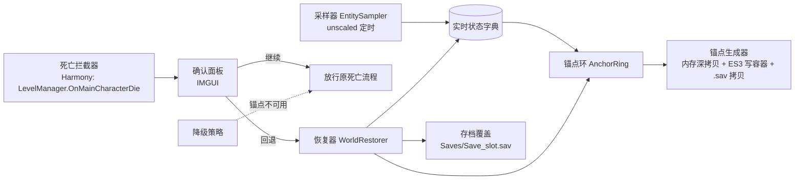

# 死亡回档 Mod（Death Rewind）设计文档

- 日期：2026-10-20
- 目标游戏：《逃离鸭科夫》/ Escape from Duckov，Steam 版 2.3.30，macOS（`Duckov.app`）
- 目标平台：Unity Mono 后端（非 IL2CPP），原生 Mod 加载机制 + Harmony 2.4.1

## 1. 目标

做一个 Mod：**战斗中被击杀时冻结游戏并弹出确认框，选择"回退"则把整个世界状态回滚到约 120 秒前**，而不是接受死亡结算。

成功判据：

1. 玩家在关卡中被击杀 → 游戏立刻冻结，弹出"继续（接受死亡）/ 回退"两个选项。
2. 选择回退 → 玩家复活，血量、位置、背包、装备回到锚点时刻；敌人、战利品箱、门、世界时间也回到锚点时刻；任务/经济/EXP 等存档状态同步回滚。
3. 恢复过程无崩溃；无法回退时（例如锚点缺失）自动退化为"接受死亡"，游戏表现与原版一致。
4. 回退后不足 120 秒再次死亡，仍可再回退一次（更早的锚点）。

非目标：

- 不修改游戏本体代码、不做存档格式修改。
- 不做"无限回退"（锚点数量有上限）。
- 不做多人/联机相关（游戏本身为单机）。
- 不做关卡重载式的"回到关卡开头"。

## 2. 术语

| 术语 | 含义 |
|---|---|
| 锚点（Anchor） | 某一时刻的完整世界状态快照，含内存态与存档副本 |
| 锚点网格 | 从关卡开始，每 `anchorInterval` 秒生成一个锚点 |
| 锚点环 | 环形保留最近 `anchorCount` 个锚点 |
| 已消耗锚点 | 曾作为恢复目标的锚点，不再被选中 |
| 采样 | 把当前世界实体状态写入"实时状态字典"（非锚点） |
| 冻结 | `Time.timeScale = 0` |

## 3. 已核实的游戏事实

全部来自本地反编译（`TeamSoda.Duckov.Core.dll`，用 `ilspycmd` 重建），非猜测。

| 事实 | 证据 |
|---|---|
| 主存档为 ES3 文件 `Saves/Save_{slot}.sav` | `Saves.SavesSystem.GetFilePath` |
| 存档只覆盖玩家与元系统（背包/血量/经济/任务/门开关），不含敌人 AI 与战利品生成 | `LevelManager.SaveMainCharacter`、`SetDoorOpenIfSaveData`、全工程无世界实体注册表 |
| 容器背包注册表存在 | `LevelManager.LootBoxInventories`（`Dictionary<int, Inventory>`） |
| 背包/物品有现成序列化 | `Saves.ItemSavesUtilities.Save(this Inventory, string)` / `LoadInventory(string, Inventory)` |
| 死亡链路 | `CharacterMainControl.OnDead` → `LevelManager.OnMainCharacterDie` → `CharacterDieTask`（2.5s 后 `ClosureView` → 失败场景） |
| 死亡会置位多个私有状态 | `LevelManager.dieTask`、`CharacterMainControl.hasHandledDeath`、`Health.isDead`、`RaidUtilities.RaidInfo.dead` |
| 敌人死亡后 GameObject 被停用并 0.5s 后销毁 | `Health.Hurt`（`SetActive(false)`）、`Health.DestroyOnDelay`（`DeadDestroyDelay = 0.5f`） |
| 敌人由场景内 Spawner 生成 | `RandomCharacterSpawner`、`WaveCharacterSpawner`、`CharacterSpawnerGroup` 等 |
| 战斗中已有仅含坐标的位置备份（20 条，3 秒间隔） | `PlayerPositionBackupManager`（与本 Mod 无关，不复用） |
| Mod 加载机制 | 扫描 `Duckov.app/Contents/Mods/<Mod>/`，读 `info.ini` 的 `name` 作为命名空间，加载该命名空间下的 `ModBehaviour` 类；Harmony 不内置，需自带 2.4.1 |

## 4. 总体架构



| 单元 | 职责 | 依赖 |
|---|---|---|
| `ModBehaviour` | Mod 入口，装配所有单元，响应关卡初始化/卸载 | 全部 |
| `RewindClock` | unscaled 时间轴、锚点网格调度（纯 C#，无 Unity 依赖） | 无 |
| `EntitySampler` | 枚举关卡实体（玩家/敌人/容器/门），把状态写入实时字典 | Unity API |
| `LiveStateStore` | `实体键 → 实体状态` 字典；提供深拷贝出锚点 | 纯 C# |
| `AnchorRing` | 环形保存 K 个锚点，按规则选出回退目标 | 纯 C# |
| `AnchorBuilder` | 在锚点时刻生成锚点：内存深拷贝 + 容器 ES3 写入 + 主存档文件拷贝 | Unity + ES3 |
| `WorldRestorer` | 差量应用锚点；复位玩家死亡状态 | Unity API |
| `DeathInterceptor` | Harmony 前置补丁拦截死亡，冻结、等待裁决、放行 | Harmony |
| `EnemyPersistencePatch` | Harmony 前置补丁阻止 `Health.DestroyOnDelay` 销毁敌人 | Harmony |
| `RewindPrompt` | IMGUI 确认面板（鼠标 + 快捷键） | Unity IMGUI |
| `ModConfig` | JSON 配置读写 | EasySave3 / JSON |

依赖方向单向，无环；纯逻辑单元（`RewindClock`、`LiveStateStore`、`AnchorRing`）不引用 Unity，可独立单测。

## 5. 快照数据模型

所有锚点数据写入 mod 私有路径 `Saves/ModRewind/`，**不污染主存档**。

### 5.1 实体键（必须跨快照稳定）

| 实体 | 键 | 来源 |
|---|---|---|
| 玩家 | 常量 `"player"` | `LevelManager.MainCharacter` |
| 敌人 | `"enemy:" + Health.GetInstanceID()` | `Health` 组件 |
| 容器 | `"loot:" + int key` | `LevelManager.LootBoxInventories` 的 key |
| 门 | `"door:" + Door.GetInstanceID()` | `Door` 组件 |

`GetInstanceID()` 在同一关卡会话内稳定，足以支撑"关卡内回滚"这一目标。关卡切换后整个锚点环作废。

### 5.2 状态字段

| 实体 | 快照内容 | 恢复动作 |
|---|---|---|
| 玩家 | 位置、旋转、`Health.CurrentHealth`、`CharacterItem.Inventory.Save` | 传送 + `SetHealth` + `LoadInventory` 覆盖背包 |
| 敌人 | 位置、旋转、血量、存活标记、`AICharacterController` 目标 | 锚点活着→写回；锚点活着而现在死了→复活；现在活着而锚点里没有→销毁 |
| 容器 | `Inventory.Save` | `LoadInventory` 覆盖内容（把 120s 内拿走的物品放回） |
| 门 | `closed` 布尔 | `ForceSetClosed(closed, triggerEvent:false)` |
| 杂项 | `TimeOfDayController` 时刻、`FogOfWar` 已探索格 | 写回 |
| 子弹 | 不快照 | 回退时清空 `BulletPool`（锚点时刻在飞的子弹无法原样复原） |

### 5.3 敌人存活策略

敌人死亡后 GameObject 会在 0.5s 后被销毁。为使"复活被击杀的敌人"可行，`EnemyPersistencePatch` 拦截 `Health.DestroyOnDelay`：Mod 启用期间，被采样器跟踪的敌人死亡后**不销毁**，仅停用并留在注册表里。

代价：尸体对象会累积。缓解：采样器在锚点滑出锚点环（超过 `anchorCount × anchorInterval`）时释放并销毁这些停用对象。

## 6. 锚点调度与选择规则

### 6.1 参数（默认，可配置）

| 参数 | 默认 | 说明 |
|---|---|---|
| `anchorInterval` | 60 s | 锚点网格间隔 |
| `anchorCount` | 3 | 环形保留的锚点数量 |
| `minRewindAge` | 120 s | 回退目标锚点的最小年龄 |

### 6.2 生成

- 锚点网格以关卡开始时刻为原点，每 `anchorInterval` 生成一个锚点，环形保留 `anchorCount` 个。
- 锚点内容：实时状态字典的**内存深拷贝** + 容器/背包的 ES3 写入（`Saves/ModRewind/anchor_{n}.es3`）+ 主存档文件拷贝（`Saves/ModRewind/save_{n}.sav`）。
- 内存深拷贝廉价，可高频做；ES3 与文件拷贝较重，只在锚点时刻做（默认 60 秒一次）。

### 6.3 选择规则

死亡时目标锚点 = 同时满足以下条件的锚点中**时间最新**的一个：

1. 年龄 ≥ `minRewindAge`（120 s）
2. 未被用作上一次恢复目标（"已消耗"）

首次死亡 → 选中 120–180 s 前；回退后马上再死 → 排除已消耗锚点，选中 180–240 s 前；第三次死亡 → 无合格锚点，退化为接受死亡。

### 6.4 回退后的时间轴

恢复不改变关卡起点与网格原点；锚点仍按原网格时间戳标识，但"年龄"按当前时间计算。恢复后 `LiveStateStore` 被锚点状态整体替换，后续采样从该状态继续。

## 7. 死亡拦截与回退时序

```
死亡发生 → LevelManager.OnMainCharacterDie
   ├─ 前置补丁命中 且 有可用锚点 且 Mod 未禁用
   │     1. Time.timeScale = 0（冻结）
   │     2. 记录死亡上下文（DamageInfo）
   │     3. 打开 IMGUI 面板，等待选择（采样器暂停写入，unscaled 时钟继续）
   ├─ 玩家选「回退」
   │     4. WorldRestorer 应用锚点（差量：写回 / 复活 / 销毁 / 覆盖存档）
   │     5. 玩家复位：hasHandledDeath=false、Health.isDead=false、SetHealth、SetInvincible(false)、
   │        gameObject.SetActive(true)、RaidUtilities.RaidInfo.dead=false、LevelManager.dieTask=false
   │     6. Time.timeScale = 1，关闭面板，标记该锚点已消耗
   └─ 玩家选「继续」
         7. Time.timeScale = 1，放行 → 重新调用原方法 → 游戏原有死亡流程照常执行
```

拦截点选择 `LevelManager.OnMainCharacterDie`（`private`，前置补丁返回 `false` 阻止原方法）：

- 早于 `CharacterDieTask`，因此 `ClosureView` 与失败场景切换都不会发生，回退不需要重载关卡。
- `dieTask` 提供幂等守卫；放行时重新触发原方法即可恢复原流程，无需改动游戏本体代码。

## 8. 降级与容错

| 情形 | 行为 |
|---|---|
| 无可用锚点（刚进关卡、锚点已耗尽、Mod 禁用） | 不拦截，直接放行原死亡流程 |
| 锚点生成失败（ES3 写入异常、磁盘错误） | 记录日志，丢弃该锚点，其余锚点不受影响 |
| 恢复过程抛异常 | 捕获后中止恢复 → 转为"放行死亡"路径；`timeScale` 在 `finally` 中保证还原 |
| 场景切换/关卡卸载 | 强制还原 `timeScale`，清空锚点环与实时字典 |
| 存档覆盖失败 | 先把原 `Save_{slot}.sav` 备份为 `Save_{slot}.sav.rewind_bak`，失败时自动回滚该备份 |
| 与其他 Mod 冲突 | `info.ini` 的 `name` 取唯一值 `DeathRewind` |

降级判定在拦截前完成，保证"不能回退"时游戏表现与原版完全一致。

## 9. 配置

文件：`Duckov.app/Contents/ModConfig/DeathRewind/config.json`（沿用游戏现有 ModConfig 目录约定）。

| 键 | 默认 | 说明 |
|---|---|---|
| `enabled` | `true` | 总开关 |
| `anchorInterval` | `60` | 锚点间隔（秒） |
| `anchorCount` | `3` | 锚点数量 |
| `minRewindAge` | `120` | 最小回退年龄（秒） |
| `promptEnabled` | `true` | `false` 时死亡即自动回退（无面板） |
| `autoRewind` | `false` | 仅测试用：无面板直接回退 |
| `rewindHotkey` | `F9` | 确认回退 |
| `continueHotkey` | `Escape` | 接受死亡 |
| `logVerbose` | `false` | 详细日志 |

## 10. 工程结构与构建

```
mod-duckov/
  src/DeathRewind/                 # Mod 本体（netstandard2.1）
    DeathRewind.csproj
    ModBehaviour.cs
    Core/{RewindClock,LiveStateStore,AnchorRing,AnchorBuilder,EntitySampler}.cs
    Core/WorldRestorer.cs
    Harmony/{DeathInterceptor,EnemyPersistencePatch}.cs
    UI/RewindPrompt.cs
    Config/ModConfig.cs
    info.ini
  tests/DeathRewind.Tests/          # 纯逻辑单测（net8.0，不引用 Unity）
  tools/build.sh                    # 构建 + 部署到 Duckov.app/Contents/Mods/DeathRewind/
  docs/superpowers/specs/           # 本设计文档
```

构建要点：

- 目标框架 `netstandard2.1`（与游戏 Mono 运行时兼容）；Harmony 2.4.1 以 `nuget` 引用并随 Mod 一起打包（游戏不内置 Harmony，且不同版本共存会冲突）。
- 游戏程序集引用指向 `Duckov.app/Contents/Resources/Data/Managed/`（`TeamSoda.Duckov.Core.dll`、`UnityEngine*.dll`、`EasySave3.dll`），路径通过 MSBuild 属性 `DuckovManagedDir` 传入，默认值指向本机安装路径，可用 `-p:DuckovManagedDir=...` 覆盖。
- 部署：`tools/build.sh` 构建后把 `DeathRewind.dll`、`info.ini`、`preview.png`、Harmony 依赖复制到 `Duckov.app/Contents/Mods/DeathRewind/`。
- `info.ini` 的 `name=DeathRewind`，对应命名空间下必须有 `ModBehaviour` 类。

## 11. 验证策略

1. **纯逻辑单测**（`tests/DeathRewind.Tests`，net8.0，不依赖 Unity）：锚点选择规则（年龄门槛、已消耗排除、耗尽后返回空）、实时状态字典的深拷贝隔离、锚点环的环形保留与滑出释放。
2. **构建与加载**：构建 → 部署 → 启动游戏 → 读 Unity `Player.log`（macOS 默认 `~/Library/Logs/Company/TeamSoda/Duckov/Player.log`）确认 Mod 加载、锚点按 60 秒节奏生成、无异常。
3. **死亡流程**（真实游戏内验证）：用 Frida 附加到 Duckov 进程，对主角色造成致命伤害触发死亡 → 日志确认"已拦截、面板已打开" → 用快捷键触发回退 → 日志确认锚点已应用、玩家存活、位置/血量恢复、锚点标记为已消耗。
4. **连续回退**：回退后立刻再次致死 → 确认选中更早的锚点；第三次致死 → 确认退化为正常死亡流程。
5. **存档一致性**：回退前后对比 `Save_{slot}.sav` 的关键键（EXP、任务进度），确认时间线一致、无重复领奖。

## 12. 风险与缓解

| 风险 | 影响 | 缓解 |
|---|---|---|
| 敌人停用对象累积 | 内存/性能 | 锚点滑出锚点环时释放并销毁 |
| `Inventory.LoadInventory` 是异步 | 恢复时序 | 恢复流程整体异步化，`timeScale` 保持 0 直到恢复完成；加超时兜底（超时则按"放行死亡"处理） |
| 私有字段复位依赖反射 | 游戏更新后失效 | 集中到单一 `PrivateStateAccessor` 单元，失效时集中报错并降级 |
| 恢复与游戏自身保存竞争 | 存档损坏 | 覆盖前备份，失败自动回滚备份 |
| 锚点间隔过小 | IO 压力 | 默认 60 秒；采样（内存）与落盘（ES3/文件）分离，落盘只在锚点时刻 |
| 世界时间/天气/任务阶段等未纳入快照 | 回退后局部不一致 | 已知不一致项在恢复日志中显式列出，避免"静默不一致" |
