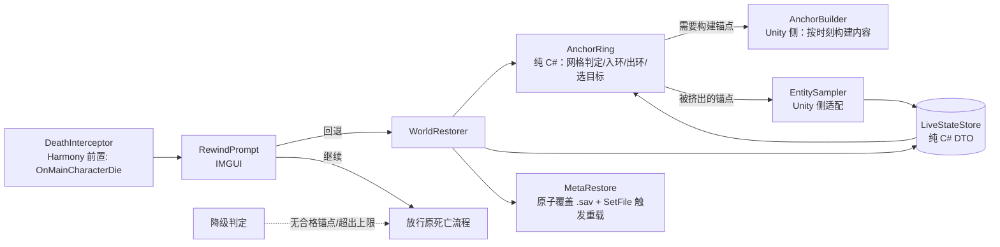

# 死亡回档 Mod（Death Rewind）设计文档

- 日期：2026-10-20（第 6 版：终版，按第 5 轮评审意见修订）
- 目标游戏：《逃离鸭科夫》/ Escape from Duckov，Steam 版 2.3.30，macOS（`Duckov.app`）
- 目标平台：Unity Mono 后端（非 IL2CPP），原生 Mod 加载机制 + Harmony 2.4.1

## 1. 目标

做一个 Mod：**战斗中被击杀时冻结游戏并弹出确认框，选择"回退"则把整个世界状态回滚到约 120–180 秒前**，而不是接受死亡结算。

成功判据：

1. 玩家在关卡中被击杀 → 死亡链路第二步（`LevelManager.OnMainCharacterDie`）被拦截，游戏冻结，弹出"继续（接受死亡）/ 回退"两个选项。
2. 选择回退 → 玩家复活，血量、位置、背包、装备回到锚点时刻；敌人、战利品箱、门、世界时间也回到锚点时刻；任务/经济/EXP 等元系统通过存档重载机制同步回滚。
3. 恢复过程无崩溃；**回退失败时玩家仍处于死亡态、玩家背包与元系统（磁盘 + 内存双侧）保持回退前状态、世界状态不出现混合态**；在拦截前判定不可回退时，游戏表现与原版完全一致。
4. 回退后不足 120 秒再次死亡，仍可再回退一次（更早的锚点）。**前置：关卡已运行 ≥ 约 `anchorCount × anchorInterval`（默认 240 s），否则环内不存在第二个满足年龄门槛的锚点。**
5. 单局回退次数不超过 `maxRewinds`（默认 3），达到上限后退化为正常死亡流程。

非目标：

- 不修改游戏本体代码、不做存档格式修改。
- 不做"无限回退"——回退次数由 `maxRewinds` 显式封顶。
- 不做多人/联机相关（游戏本身为单机）。
- 不做关卡重载式的"回到关卡开头"。
- 不回滚死亡瞬间已经触发的表现类副作用（死亡动画、击杀计数播报等），详见 §13 未覆盖清单。

## 2. 术语

| 术语 | 含义 |
|---|---|
| 锚点（Anchor） | 某一时刻的完整世界状态快照，含内存态、容器/背包数据与主存档副本 |
| 有效 tick | 自 Mod 启动起的单调秒数，**冻结时长不计入**（`CurrentTick`） |
| 锚点时间戳 | 锚点的 `AbsTimestamp`（有效 tick 域）与 `GridTimestamp`（网格时间戳）两个值 |
| 网格原点 | 网格排布新锚点的起点，回退成功后重置为所选锚点的 `GridTimestamp` |
| 锚点年龄 | `CurrentTick − AbsTimestamp`，**与网格原点无关** |
| 锚点环 | 环形保留最近 `anchorCount` 个锚点 |
| 已消耗锚点 | 曾作为恢复目标的锚点；**在同一关卡内永不再被选中** |
| 回退次数 | 本关卡内**已成功执行**的回退次数，上限 `maxRewinds` |
| 死亡上下文 | 拦截时捕获的原始 `DamageInfo` 实例 + `DeathSnapshot`（Unity 侧对象，不进 DTO） |
| 死亡态快照 | 拦截时刻直接从游戏对象读到的玩家死亡状态，作为反向复位的唯一权威来源 |
| 回退前世界快照 | 回退开始时刻读到的世界侧状态，作为失败补偿的权威来源 |
| 采样 | 把当前世界实体状态写入"实时状态字典"（非锚点） |
| 冻结 | `Time.timeScale = 0` |

## 3. 已核实的游戏事实

全部来自本地反编译（`TeamSoda.Duckov.Core.dll`、`ItemStatsSystem.dll`）与本地 `Managed/` 目录检查，用 `ilspycmd` 重建，非猜测。实现时若发现与本文不符，以反编译结果为准并同步修订本文。

| 事实 | 证据 |
|---|---|
| 主存档为 ES3 文件 `Saves/Save_{slot}.sav`，路径由 `SavesSystem.GetFilePath(slot)` 给出（相对 `Application.persistentDataPath`） | `Saves.SavesSystem` |
| `SavesSystem.CurrentSlot` 是公开只读属性（setter 私有） | `Saves.SavesSystem` |
| `SavesSystem.CollectSaveData()`、`SavesSystem.SaveFile()`、`SavesSystem.SetFile(int)` 均为公开静态方法；`SaveFile()` 内部 `CreateBackup()`、可能 `CreateIndexedBackup()`、`ES3.StoreCachedFile(CurrentFilePath)`；`SetFile` 置 `cached=false` 并重新 `CacheFile()` 后触发 `OnSetFile` | `Saves.SavesSystem` |
| `LevelManager.SaveMainCharacter()` 是 `internal` → **Mod 无法直接调用**；玩家物品数据在主存档中的刷新只能由游戏自身触发 | `LevelManager.cs` |
| 存档只覆盖玩家与元系统（背包/血量/经济/任务/门开关），不含敌人 AI 与战利品生成 | `LevelManager.SaveMainCharacter`、`SetDoorOpenIfSaveData`、游戏侧无世界实体注册表 |
| 容器背包注册表存在 | `LevelManager.LootBoxInventories`（`Dictionary<int, Inventory>`） |
| 背包/物品有现成序列化，且可**原地恢复**：`InventoryData.FromInventory(inv)` / `await InventoryData.LoadIntoInventory(data, inv)`；物品侧 `ItemTreeData.FromItem(item)` / `ItemTreeData.InstantiateAsync(data)` | `ItemStatsSystem.dll` |
| `Inventory.DestroyAllContent()` 是公开方法 | `ItemStatsSystem.Inventory` |
| 游戏自带的 `Inventory.Save(key)` / `Item.Save(key)` 会写入**主存档**，因此 Mod 不使用它们，改用自建 ES3 文件 | `Saves.ItemSavesUtilities.Save` → `SavesSystem.Save` |
| 元系统重载机制：`SavesSystem.SetFile(slot)` 触发 `OnSetFile`；订阅并从存档重载的系统有 `EXPManager`、`QuestManager`、`EconomyManager`、`StockShop`、`PerkTree`、`ItemShortcut`、`NoteIndex`、`GameRulesManager` 等 | `Saves.SavesSystem.SetFile` 与各系统的 `OnSetFile +=` |
| **`LevelManager` 与 `CharacterMainControl` 均未订阅 `OnSetFile`** → 重载不会改写玩家的内存态，玩家状态由本 Mod 独占恢复 | 订阅者清单中无此二者 |
| 死亡链路 | `CharacterMainControl.OnDead` → `Health.OnDeadEvent` → `LevelManager.OnMainCharacterDie(DamageInfo)` → `CharacterDieTask`（2.5s 后 `ClosureView` → 失败场景） |
| `OnMainCharacterDie` 是 `private void (DamageInfo)`，以 `mainCharacter.Health.OnDeadEvent.AddListener` 方式注册 | `LevelManager.cs:400,648` |
| `LevelManager.dieTask` 是 `private bool`，作幂等守卫 | `LevelManager.cs:130,650` |
| 死亡会置位多个私有状态 | `LevelManager.dieTask`、`CharacterMainControl.hasHandledDeath`、`Health.isDead`、`RaidUtilities.RaidInfo.dead` |
| `CharacterItem` 是只读属性 → 玩家背包只能**原地恢复** | `CharacterMainControl.cs:363` |
| `RaidUtilities.RaidInfo` 是公开结构体，`dead` 是公开字段；`CurrentRaid` 是公开 getter、setter 私有，写入路径为 `SavesSystem.Save("RaidInfo", info)`；`CurrentRaid` 每次从存档实时读取 | `RaidUtilities.cs:15,34,54` |
| `DamageInfo` 是公开结构体且字段公开；`Health.Hurt(DamageInfo)` 是公开方法 → Mod 可构造致死伤害作为调试入口，也可复用拦截时捕获的原始实例 | `DamageInfo.cs`、`Health.cs:308` |
| AI 复位入口是公开 API：`AICharacterController.SetTarget(Transform)`、`StopMove()`、`noticed` 公开字段；`Init(...)` 是重量级初始化，**不复用** | `AICharacterController.cs:538,523,59` |
| 敌人死亡后 GameObject 被停用并在 0.5s 后销毁 | `Health.Hurt`（`SetActive(false)`）、`Health.DestroyOnDelay`（`DeadDestroyDelay = 0.5f`） |
| 敌人由场景内 Spawner 生成 | `RandomCharacterSpawner`、`WaveCharacterSpawner`、`CharacterSpawnerGroup` 等 |
| `Door.ForceSetClosed(bool closed, bool triggerEvent)`、`Health.SetHealth(float)`、`Health.SetInvincible(bool)`、`TimeOfDayController.Time`（只读 getter）、`Projectile` 类均存在 | 各对应源码文件 |
| `Health.DestroyOnDelay` 是 `private async UniTask` | `Health.cs:469` |
| `UniTask.dll` 存在于游戏 `Managed/` 目录 → **必须引用游戏自带的那一份，不得随 Mod 打包** | 目录检查 |
| `Newtonsoft.Json.dll` 亦存在，但本 Mod **不使用 JSON**（§9 采用 `key=value` 文本格式），以避免共享程序集风险 | 目录检查 |
| 关卡开始事件源 | `LevelManager.OnLevelBeginInitializing` / `OnLevelInitialized` / `OnAfterLevelInitialized` |
| 子场景加载事件源 | `MultiSceneCore.OnSubSceneLoaded`（每次进房间都会触发） |
| 场景切换事件源 | `SceneLoader.onStartedLoadingScene` / `onFinishedLoadingScene`（公开静态事件）、`SceneManager.sceneUnloaded`（Unity 内置） |
| 关卡/局结束事件源 | `RaidUtilities.OnRaidEnd`（撤离或死亡结算时触发）、`SceneLoader.onStartedLoadingScene` |
| Mod 配置目录约定 | `Duckov.app/Contents/ModConfig/<ModName>/config.json`（本机实例：`Contents/ModConfig/BattlefieldTypeKillNotice/config.json`） |
| 战斗中已有仅含坐标的位置备份（20 条，3 秒间隔） | `PlayerPositionBackupManager`（与本 Mod 无关，不复用） |
| Mod 加载机制 | 扫描 `Duckov.app/Contents/Mods/<Mod>/`，读 `info.ini` 的 `name` 作为命名空间，加载该命名空间下的 `ModBehaviour` 类；Harmony 不内置，需自带 2.4.1 |

## 4. 总体架构



### 4.1 单元表

| 单元 | 所在目录 | 职责 | 依赖 |
|---|---|---|---|
| `ModBehaviour` | `src/DeathRewind/` | Mod 入口，装配所有单元；每帧向 `RewindClock` 注入时间；统一收口 `timeScale` 复位（try/finally）；处理调试热键 | 全部 |
| `LevelHooks` | `src/DeathRewind/Unity/` | 关卡生命周期适配：订阅 §3 事件源，判定"关卡开始 / 子场景加载 / 场景切换 / 关卡结束"并对外发事件 | Unity |
| `RewindClock` | `src/DeathRewind/Core/` | **纯逻辑**时钟：接受注入的时间 tick 与冻结信号，维护有效 tick、网格原点、网格边界 | 无 |
| `AnchorRing` | `src/DeathRewind/Core/` | **纯逻辑**锚点环：网格推进判定（何时该建锚点）、入环/出环、被挤出列表、目标选择、已消耗集合、回退计数 | 无 |
| `LiveStateStore` | `src/DeathRewind/Core/` | `实体键 → DTO` 字典；提供深拷贝出锚点 | 无 |
| `Dto` | `src/DeathRewind/Core/` | 纯 C# DTO 与 `Anchor` 记录定义 | 无 |
| `EntitySampler` | `src/DeathRewind/Unity/` | Unity 侧适配：枚举关卡实体 → DTO 写入 `LiveStateStore`；维护稳定 ID 注册表；响应出环事件释放停用敌人 | Unity API |
| `AnchorBuilder` | `src/DeathRewind/Unity/` | **按指定时刻**构建锚点内容：元系统刷新 + DTO 深拷贝 + 容器/背包写自建 ES3 文件 + 主存档文件拷贝 | Unity + ES3 |
| `WorldRestorer` | `src/DeathRewind/Unity/` | 差量应用锚点；恢复玩家；执行阶段 A–F | Unity API + ES3 |
| `MetaRestore` | `src/DeathRewind/Unity/` | 主存档原子覆盖/回滚与元系统重载 | ES3 + `SavesSystem` |
| `DeathInterceptor` | `src/DeathRewind/Harmony/` | Harmony 前置补丁拦截死亡，冻结、等待裁决、按 bypass 标志放行 | Harmony |
| `EnemyPersistencePatch` | `src/DeathRewind/Harmony/` | Harmony 前置补丁接管 `Health.DestroyOnDelay`：登记死亡敌人并阻止销毁 | Harmony |
| `RewindPrompt` | `src/DeathRewind/UI/` | IMGUI 确认面板（鼠标 + 快捷键） | Unity IMGUI |
| `PrivateStateAccessor` | `src/DeathRewind/Compat/` | 集中反射访问私有字段（`dieTask`、`hasHandledDeath`、`Health.isDead`、`TimeOfDayController.time` 等），失效时集中报错并降级 | 反射 |
| `ModConfig` | `src/DeathRewind/Config/` | `key=value` 文本配置读写；解析失败或字段缺失时回落到默认值并记录日志 | 无 |

### 4.2 分层约束

- `Core/` 下**只允许引用 .NET 基类库**；禁止 `using UnityEngine`、任何游戏命名空间（`Duckov.*`、`Saves.*`、`ItemStatsSystem.*`、`TeamSoda.*`），也禁止引用 EasySave3（DTO 的载荷是 `byte[]`，Core 无需 ES3）。由 `tools/check-core-purity.sh` 静态检查。
- 游戏类型与 EasySave3 只出现在 `Unity/`、`Harmony/`、`Compat/`、`Config/`、`UI/` 中。
- 依赖方向单向，无环。

## 5. 快照数据模型

所有锚点数据写入 mod 私有根目录 **`<Application.persistentDataPath>/ModRewind/`**（**不在**游戏 `Saves/` 目录内，避免被游戏的存档扫描/备份逻辑看到）。

### 5.1 实体键（自建稳定 ID）

不使用 Unity 的 `GetInstanceID()` 作为身份：对象销毁后 instance ID 会被复用，会把新对象误判成旧实体。

| 实体 | 键 | 分配方式 |
|---|---|---|
| 玩家 | `"player"` | 常量 |
| 敌人 | `"enemy:{n}"` | Mod 自增序号 `n` |
| 容器 | `"loot:{key}"` | `LevelManager.LootBoxInventories` 的 `int` key |
| 门 | `"door:{n}"` | Mod 自增序号 `n` |

`EntitySampler` 维护 `UnityEngine.Object 引用 → 稳定 ID` 的注册表；被跟踪的敌人因 §5.4 的销毁接管而存活，引用不会失效。新实体获得新序号，不会与旧锚点里的 ID 冲突。

**场景卸载时注册表自愈**：注册表在每次采样时剔除引用为 null（Unity 的"伪 null"）的条目；被剔除的稳定 ID 不再复用。

### 5.2 DTO 与锚点记录（纯 C#）

| DTO / 记录 | 字段 | 说明 |
|---|---|---|
| `PlayerState` | 位置 `float[3]`、旋转 `float[4]`、血量、存活标记、背包 `byte[]`（ES3 序列化的 `InventoryData`） | 背包载荷不透明 |
| `EnemyState` | 位置、旋转、血量、存活标记、AI 目标稳定 ID | |
| `ContainerState` | 键、容量、锁定格、物品载荷 `byte[]` | 载荷不透明 |
| `DoorState` | `closed` 布尔 | |
| `WorldState` | 世界时间（`TimeOfDayController.Time`） | 只含已核实可读写的字段；其余明确列入 §13 |
| `DeathSnapshot` | 血量、`isDead`、`hasHandledDeath`、`GameObject.activeSelf`、`RaidInfo.dead`、`invincible`、玩家位置 `float[3]`、玩家旋转 `float[4]`、玩家背包 `byte[]` 副本 | 反向复位的唯一权威来源（纯 C#，不含 `DamageInfo`） |
| `PreRewindSnapshot` | 世界时间、玩家位置/旋转、玩家背包副本、各容器 `InventoryData` 副本、各门 `closed`、各敌人实时态 | 失败补偿的权威来源 |
| `Anchor`（记录） | `Id`、`AbsTimestamp`、`GridTimestamp`、`Consumed`、`ContainerPayloadPath`、`MainSaveCopyPath`、`PlayerState`、`WorldState`、敌人/容器/门状态集合 | 锚点 id 单调递增；`anchor_{Id}.es3` 与 `save_{Id}.sav` 中的 n 即锚点 id |

**载荷权威源**：内存中的 `byte[]` 副本是权威源；`anchor_{Id}.es3` 文件只是冷备（跨会话/崩溃恢复用），阶段 C/E 一律读内存副本。

### 5.3 状态字段与恢复动作

| 实体 | 快照内容 | 恢复动作 |
|---|---|---|
| 玩家 | 位置、旋转、`Health.CurrentHealth`、`CharacterItem.Inventory` 的 `InventoryData` | 传送 + `SetHealth` + 背包原地还原（§8.1 阶段 E） |
| 敌人 | 位置、旋转、血量、存活标记、AI 目标 | 见 §5.5 差量表 |
| 容器 | `InventoryData` | `Inventory.DestroyAllContent()` 后 `InventoryData.LoadIntoInventory` 原地还原 |
| 门 | `closed` 布尔 | `Door.ForceSetClosed(closed, triggerEvent:false)` |
| 世界时间 | `TimeOfDayController.Time`（只读 → 经 `PrivateStateAccessor` 写私有字段 `time`） | 写回 |
| 子弹 | 不快照 | 回退时销毁场上所有 `Projectile`（**含玩家自己的子弹**） |

### 5.4 敌人存活、采样覆盖与销毁时机

`EnemyPersistencePatch` **接管** `Health.DestroyOnDelay`：前置补丁里（1）把该敌人登记进 `EntitySampler` 的注册表（分配稳定 ID，状态 `alive=false`、已停用）；（2）**跳过原方法体**，不由游戏销毁。这覆盖了"敌人生成后、下一次采样前就死亡"的窗口。

**销毁时机（延迟销毁）**：回退期间对敌人只做 `SetActive(false)` 并保留注册表；**销毁推迟到回退提交成功之后**执行。这样失败补偿时对象仍在，可反向激活。

- 锚点出环（`AnchorRing` 给出被挤出列表）→ 释放并销毁对应停用敌人；
- **未进入任何锚点的注册项**（在回退前最后一段才死）：存活时长超过 `anchorCount × anchorInterval` 且不属于任何锚点 → 淘汰并销毁；
- 关卡/场景切换 → 全部释放。

**采样必须覆盖注册表内的停用敌人**：Unity 的对象枚举只返回激活对象，因此活跃枚举仅用于**发现新实体**，已停用敌人的状态更新走注册表遍历。

**实现要点**：`Health.DestroyOnDelay` 是 `private async UniTask`。Harmony 前置补丁必须是**同步**方法，返回 `false` 即整条 async 状态机被跳过（调用方 `await` 到 `default(UniTask)` 立即完成）；写成 async prefix 会导致跳过失败。

### 5.5 差量表

**正向（锚点 → 回退目标）**：设锚点快照状态为 `A`，回退前实时状态为 `B`：

| 情况 | 动作 |
|---|---|
| `A` 活、`B` 活 | 写回位置/旋转/血量；AI 目标：目标实体仍存在则写回，否则置 null 并跳过 |
| `A` 活、`B` 死 | 复活：启用 GameObject、`Health.isDead=false`、`SetHealth(锚点血量)`、写回位置；AI 复位 `SetTarget(null)` + `StopMove()` + `noticed=false`（**不调用 `Init`**） |
| `A` 死、`B` 活 | 移除：**停用**（保留注册表与对象，销毁推迟到提交成功后） |
| `A` 死、`B` 死 | 无操作 |
| `A` 无、`B` 活 | 移除：**停用**（同上） |
| `A` 活、`B` 无 | **不复活**（对象已被游戏销毁，无预制体来源可重建）；记入 §13 |

**反向（回退前 → 补偿目标）**：设回退前状态为 `B`（来自 `PreRewindSnapshot`），当前（可能已被部分回退的）状态为 `X`：

| 情况 | 动作 |
|---|---|
| `B` 活、`X` 活 | 写回 `B` 的位置/旋转/血量/AI 目标 |
| `B` 活、`X` 死 | 复活（同正向表）后写回 `B` 的状态 |
| `B` 活、`X` 无（已停用但对象仍在） | **重新激活**（`SetActive(true)`）+ 写回 `B` 的状态 |
| `B` 活、`X` 无（对象已被销毁） | 无法复活 → 记入 §13 |
| `B` 死、`X` 活 | 停用 |
| `B` 死、`X` 死 | 无操作 |
| `B` 无、`X` 活 | 停用 |
| 容器 | `DestroyAllContent` + `InventoryData.LoadIntoInventory(B 的副本)` |
| 门 | `ForceSetClosed(B.closed, triggerEvent:false)` |
| 世界时间 | 写回 `B` 的时间 |
| 玩家位置/旋转 | 写回 `B` 的位置/旋转 |

## 6. 锚点调度与选择规则

### 6.1 参数（默认，可配置）

| 参数 | 默认 | 说明 |
|---|---|---|
| `anchorInterval` | 60 s | 锚点网格间隔 |
| `anchorCount` | 4 | 环形保留的锚点数量 |
| `minRewindAge` | 120 s | 回退目标锚点的最小年龄 |
| `maxRewinds` | 3 | 单关卡内回退次数上限 |
| `sampleInterval` | 0.25 s | 内存采样频率（不落盘） |

### 6.2 时间基准、坐标系与时钟注入

- 时间源是 Unity 的 `Time.unscaledTime`，**由 Unity 侧注入**：`ModBehaviour.Update` 每帧调用 `RewindClock.Tick(Time.unscaledTime)`。`RewindClock` 自身是纯逻辑类，不引用 Unity（§4.2）。
- `RewindClock` 维护两个量：
  - `RawTime` = 注入的原始 unscaled 时间（仅日志用）；
  - `CurrentTick` = **有效 tick**：冻结期间不累加（`Tick` 在 `IsFrozen` 时只更新 `RawTime`）。
- **锚点时间戳一律存于有效 tick 域**：`AbsTimestamp = CurrentTick`（自 Mod 启动起的**有效**秒数，冻结时长不计入）。锚点年龄 `Age = CurrentTick − AbsTimestamp`，**与网格原点无关**。
- 网格排布另用 `GridTimestamp`（网格时间戳）：网格原点被重置时，**已有锚点的 `AbsTimestamp` 与 `Age` 不变**，只影响此后新锚点的 `GridTimestamp`。
- 冻结期间网格推进与年龄累加**同时暂停**。
- `RewindClock` 对外 API：`CurrentTick`、`GridTime`、`RawTime`、`IsFrozen`、`Tick(float)`、`Freeze()`、`Resume()`、`ResetGridOrigin(float gridTimestamp)`。

### 6.3 生成与网格编排（owner = `AnchorRing`）

- `AnchorRing`（纯逻辑）负责全部网格编排：
  - 判定"是否跨过网格边界"→ 返回**待构建锚点时刻**（`AbsTimestamp`、`GridTimestamp`）；
  - 收到构建完成的锚点后**入环**；入环时若超出 `anchorCount`，**挤出最老锚点**并把挤出列表返回给 Unity 侧（用于释放停用敌人）。
- `AnchorBuilder`（Unity 侧）**只负责按指定时刻构建锚点内容**：
  1. **元系统刷新**：`SavesSystem.CollectSaveData()` + `SavesSystem.SaveFile()`（让主存档反映锚点时刻的 EXP/任务/经济；副作用是刷新游戏自身的 `.bac` 备份，与游戏在 UI 开关时做的事一致）。`LevelManager.SaveMainCharacter()` 是 `internal`，Mod 无法调用 → 玩家数据由本 Mod 自己的背包快照负责（§5.3）。
  2. 实时状态字典的**内存深拷贝**（每 `sampleInterval` 一次更新，锚点时刻取快照）。
  3. 容器/背包的 ES3 写入（`<persistentDataPath>/ModRewind/anchor_{Id}.es3`）。
  4. 主存档文件拷贝（`<persistentDataPath>/ModRewind/save_{Id}.sav`）。
- **冻结期间不生成锚点**（网格暂停）。
- **文件清理**：锚点出环时删除其 `anchor_{Id}.es3` 与 `save_{Id}.sav`；关卡结束时清理剩余锚点文件；Mod 启动时清理目录中的孤儿文件（文件名不匹配任何现存锚点）。

### 6.4 回退准入与目标选择

**准入判定**（在拦截前完成，失败即放行原死亡流程）：

1. Mod 已启用；
2. 本关卡 `rewindCount < maxRewinds`；
3. 锚点环中存在满足下列两条的锚点。

**目标锚点** = 满足下列两条的锚点中**时间最新**的一个：

1. `Age ≥ minRewindAge`（120 s）；
2. **未被用作任何一次恢复目标**（已消耗集合，同关卡内永不复用）。

### 6.5 回退成功后的锚点处置（关键）

回退到锚点 `G` 后：

- **移除"回退时刻已存在于环中、且 `AbsTimestamp > G.AbsTimestamp`"的全部锚点**——它们属于被丢弃的那段时间线，若保留，玩家之后可以回退到"已丢弃时间线上的中间状态"，把那段人生里拾取的战利品一并还原回来（战利品重复利用路径）。
- **网格原点重置为 `G.GridTimestamp`**；此后新锚点从该原点继续生成。**此后新生成的锚点不受上一条限制**（它们属于新时间线）。
- `G` 标记为已消耗；更早的锚点保留，仍可作为下一次回退目标。
- 按 §6.2，网格原点重置**不改变**保留锚点的 `Age`。

### 6.6 推演（参数 `interval=60`、`count=4`、`minAge=120`、`maxRewinds=3`）

前提：关卡已运行 ≥ `4 × anchorInterval`（240 s），环内锚点年龄区间约为 `(0–60] / (60–120] / (120–180] / (180–240]`。

**场景 A：三次死亡落在同一个 60 秒网格窗口内**（回退耗时未跨过网格边界）

| 死亡时机 | 合格锚点 | 结果 |
|---|---|---|
| 第 1 次死亡 | 年龄落在 `(120–180]` 的那个（最新且 ≥120、未消耗） | 回退到约 120–180 s 前 |
| 回退后立刻再死 | 上一锚点已消耗，且按 §6.5 更年轻的锚点已被移除；剩余候选中年龄 ≥120 的只有 `(180–240]` 那个 | 再回退到约 180–240 s 前 |
| 第 3 次死亡 | 环已被前两次回退清空 | 无合格锚点 → 退化为接受死亡 |

**场景 B：两次死亡间隔 ≥60 秒**（新锚点进入环，最老锚点被挤出）

| 死亡时机 | 合格锚点 | 结果 |
|---|---|---|
| 第 1 次死亡 | `(120–180]` | 回退成功 |
| 之后 | 环内出现新的未消耗锚点（属于新时间线），年龄 ≥120 者仍可能被选中 | 仍可回退，但**总次数受 `maxRewinds` 封顶**，达到 3 次后退化为接受死亡 |

"已消耗集合 + `maxRewinds`"共同保证回退次数有限（§1 判据 5）。

### 6.7 回退后的时间轴

恢复不改变关卡起点；网格原点按 §6.5 重置。恢复后 `LiveStateStore` 被锚点状态整体替换，后续采样从该状态继续。

## 7. 死亡拦截与回退时序

```
死亡发生 → Health.OnDeadEvent → LevelManager.OnMainCharacterDie(DamageInfo)
   ├─ 前置补丁命中 且 准入判定通过 且 不在拦截中
   │     0. 置重入标志 interceptionActive = true
   │     1. Time.timeScale = 0（冻结）；RewindClock.Freeze()
   │     2. 采集死亡上下文：
   │        - 原始 DamageInfo 实例（重放放行时复用，避免死亡归因/击杀统计异常）
   │        - DeathSnapshot（血量、isDead、hasHandledDeath、activeSelf、
   │          RaidInfo.dead、invincible、位置/旋转、玩家背包副本）
   │     3. 打开 IMGUI 面板，等待选择（采样器暂停写入，网格暂停推进）
   ├─ 玩家选「回退」
   │     4. WorldRestorer 分阶段应用（§8.1 阶段 A–F）
   │     5a. 阶段 E 完成（回退成功）→ Time.timeScale = 1（Resume）、关闭面板、
   │         锚点标记已消耗、rewindCount++、按 §6.5 处置锚点环、
   │         执行延后的敌人销毁
   │     5b. 任一阶段失败 → 阶段 F 补偿 → 放行死亡路径；
   │         此路径下**不消耗锚点、不递增 rewindCount**（回退未成功）
   └─ 玩家选「继续」
         6. 恢复 Time.timeScale = 1（若 IsFrozen）→ 清 interceptionActive → 置 bypassNext
         7. 排队到下一帧：由反射调用 `LevelManager.OnMainCharacterDie(捕获的原始 DamageInfo)`
            （bypassNext 使前缀补丁放行），原方法正常执行 → 自行置 dieTask = true
            → CharacterDieTask → 2.5s 后 ClosureView → 失败场景
```

要点：

- 拦截点选 `LevelManager.OnMainCharacterDie`（`private void (DamageInfo)`，前置补丁返回 `false` 阻止原方法）：早于 `CharacterDieTask`，因此 `ClosureView` 与失败场景切换都不会发生，回退不需要重载关卡。
- 放行必须**显式重新调用**原方法：Harmony 前置返回 `false` 后游戏不会二次调用它。调用通过 `PrivateStateAccessor` 反射执行，并在下一帧执行。`bypassNext` 保证补丁只放行这一次。
- 原方法被拦截时**不会自行设置 `dieTask`**（方法体被跳过）；重入由 `interceptionActive` 防护，放行后由原方法正常设置 `dieTask`。
- **同一拦截窗口内最多一次回退裁决**。若冻结期间再次进入死亡链路（DoT 等以 unscaled 触发的伤害）：二次进入 → 取消本次待定回退（关闭面板、恢复 `timeScale`、清 `interceptionActive`）、置 `bypassNext` 并**放行原方法**（不吞掉死亡）；该取消路径**不再重放**原方法（避免重复调用，`dieTask` 幂等只是兜底）。
- **`timeScale` 复位不变量**：任何退出拦截面板的路径（回退成功 / 继续 / 异常 / 二次进入）都必须把 `Time.timeScale` 复位为 1。由 `ModBehaviour` 统一收口（try/finally + 状态机出口检查）。
- 该拦截点位于死亡链路第二步：此时 `Health.isDead` 已置位、玩家 GameObject 已停用、击杀计数等副作用已发生。这些副作用中未被快照覆盖的部分不会回滚（见 §13）。

## 8. 降级与容错

### 8.1 恢复的阶段顺序与失败语义

**不变量 1（玩家终态互斥）**：要么"回退成功且玩家存活"，要么"接受死亡且玩家处于死亡态"。不允许半复活。

**不变量 2（物品与元系统完整性）**：回退失败时，玩家背包与元系统必须保持**回退前**的状态，且**磁盘与缓存双侧一致**。

**不变量 3（世界侧无混合态）**：回退失败时，容器/敌人/门/世界时间/玩家位置的状态必须整体处于"锚点时刻"或整体处于"回退前时刻"。

**统一异步约束**：每个阶段的异步操作必须**可等待其终态**。超时只是"判定失败并进入补偿"的**触发条件**，**不是跳过等待的许可**；阶段 F 开始前必须断言上一阶段的异步链已静默（quiescent），否则先等待其结束再补偿。

| 阶段 | 内容 | 失败处理 |
|---|---|---|
| A 校验与准备 | **先刷新存档**：`SavesSystem.CollectSaveData()` + `SavesSystem.SaveFile()`（使"回退前状态"定义为刷新后的磁盘 + 内存双侧一致态）；再把 `Save_{slot}.sav` 备份到 `<persistentDataPath>/ModRewind/save_backup.sav`；采集 `PreRewindSnapshot`（世界时间、玩家位置/旋转与背包副本、各容器 `InventoryData` 副本、各门 `closed`、各敌人实时态）；复核 `DeathSnapshot`；校验锚点载荷可解析 | 失败/超时 → 放弃回退，走"放行死亡"路径 |
| B 元系统存档 | 原子写临时文件 → 原子改名覆盖主存档 → `SavesSystem.SetFile(SavesSystem.CurrentSlot)` 触发 `OnSetFile` 重载 | 失败/超时 → **磁盘回滚**：用同一"写 tmp → 原子改名"把 `save_backup.sav` 写回主存档路径 → 调用 `SavesSystem.SetFile(SavesSystem.CurrentSlot)`（由游戏自身 `CacheFile` 主存档并触发 `OnSetFile`；**不手动 `ES3.CacheFile` 备份路径**，避免缓存键错位）→ 校验 EXP/任务键与备份一致；二次失败 → 仍先完成磁盘回滚，再降级为"接受死亡" |
| C 容器背包 | 整体校验 → 世界容器逐个 `DestroyAllContent` + `InventoryData.LoadIntoInventory`（异步，逐个等待完成） | 失败/超时 → 等待在途链静默 → 转阶段 F 补偿 |
| D 敌人/门/时间/子弹 | 整体校验 → 按 §5.5 正向差量表恢复 | 失败/超时 → 等待在途链静默 → 转阶段 F 补偿 |
| E 玩家 | E1 复核 `DeathSnapshot` → E2 传送 + `SetHealth` + 背包原地还原（先 `DestroyAllContent` 再 `LoadIntoInventory`；失败即用 A 阶段副本回灌）→ E3 复活标志复位（`hasHandledDeath=false`、`Health.isDead=false`、`SetInvincible(false)`、`gameObject.SetActive(true)`、`LevelManager.dieTask=false`；并读取 `RaidUtilities.CurrentRaid`，若 `dead` 仍为 true 则构造修正副本（`dead=false, ended=false`）并 `SavesSystem.Save("RaidInfo", 修正值)`）→ E4 校验（`Health.CurrentHealth > 0 && !Health.isDead`）→ E5 失败则执行 E6 | E2 失败 → 回灌背包副本后走 E5；E3/E4 失败 → E6 反向复位 |
| E6 反向复位 | **以 `DeathSnapshot` 为唯一权威来源**，把 E2/E3 已改动的字段逐项改回死亡态取值：血量、`isDead`、`hasHandledDeath`、`activeSelf`、`invincible`、位置/旋转、背包内容、`RaidInfo.dead`（必要时再次 `Save("RaidInfo", …)`）、`dieTask`；随后**必须执行阶段 F**，再走"放行死亡"路径 | 反向复位失败 → **最后兜底**：用捕获的原始 `DamageInfo` 调用 `Health.Hurt(...)` 强制玩家进入死亡态，再走放行死亡；该兜底失败才允许保留半复活态，并记入 §13 |
| F 补偿 | 用 A 阶段的 `save_backup.sav` 执行与阶段 B 失败处理相同的"磁盘回滚 + `SetFile`"，把元系统还原为回退前值；再按 §5.5 **反向差量表**把世界侧（容器/门/敌人/世界时间/玩家位置）整体还原为回退前状态 | 补偿失败 → 记录严重错误并降级为"接受死亡"；磁盘优先回滚 |

阶段顺序说明：

- **B 不会改写玩家的内存态**：`LevelManager` 与 `CharacterMainControl` 均未订阅 `OnSetFile`（§3）。
- **E 是最后一步**：E3 之前的任何失败都不会让玩家复活。
- **E2 的背包原子性**：A 阶段已留存玩家背包 `InventoryData` 副本；`LoadIntoInventory` 失败时立即回灌。
- **F 的存在理由**：B 已把元系统重载为锚点时刻的值，若 C/D/E 失败却不做补偿，就会留下"元系统已回滚、玩家却死了"的矛盾状态。F 让 B 的效果可逆。
- **锚点消耗与计数**：只有阶段 E 全部成功才算"回退成功"，此时才消耗锚点并 `rewindCount++`（§7 步骤 5a/5b）。
- **超时**：各阶段异步操作都设有超时上限，超时按失败处理，但必须先等在途链静默。

### 8.2 关卡生命周期与复位

| 事件 | 来源 | 判别条件 | 动作 |
|---|---|---|---|
| 关卡开始 | `LevelManager.OnLevelInitialized`（`LevelHooks` 订阅） | — | 网格原点 = 关卡开始时刻；锚点环、已消耗集合、回退计数、实时字典**全部复位**；`rewindCount = 0` |
| 子场景加载 | `MultiSceneCore.OnSubSceneLoaded` | 加载的是**本局已登记的子场景**（`MultiSceneCore.Instance.SubScenes` 之一） | **不清空**锚点环、已消耗集合、回退计数；只刷新实体注册表；记录"锚点可能不覆盖新子场景的实体" |
| 场景切换 | `SceneLoader.onStartedLoadingScene` / `SceneManager.sceneUnloaded` | 卸载的场景**不属于**本局已登记的子场景集合 | 强制复位 `timeScale`；清空锚点环、已消耗集合、回退计数、实时字典；释放停用敌人；清理锚点文件；注册表清空重建 |
| 关卡/局结束 | `RaidUtilities.OnRaidEnd` | — | 同场景切换处理 |

**关键约束**：进房间只走"子场景加载"分支，**绝不**清空锚点环或把 `rewindCount` 归零，否则判据 4/5 同时失效。

### 8.3 主存档覆盖的原子性

- 路径由 `SavesSystem.GetFilePath(SavesSystem.CurrentSlot)` 解析（相对 `Application.persistentDataPath`）。
- 备份位于 `<persistentDataPath>/ModRewind/save_backup.sav`——mod 私有根目录，**不在游戏 `Saves/` 目录内**。
- 覆盖与回滚共用同一个原子写辅助函数："写 `Save_{slot}.sav.tmp` → 原子改名"。
- 覆盖后调用 `SavesSystem.SetFile(SavesSystem.CurrentSlot)`：它会令 `cached=false`、重新 `CacheFile()`（读取被覆盖后的文件）并触发 `OnSetFile`。
- 覆盖、重载或后续阶段失败 → 按 §8.1 的磁盘回滚流程还原；回滚后同样以 `SetFile` 让缓存指向主存档路径（**不手动 `ES3.CacheFile` 备份路径**）。

## 9. 配置

文件：`Duckov.app/Contents/ModConfig/DeathRewind/config.txt`，**`key=value` 文本格式**（每行 `key=value`，`#` 开头为注释）——刻意不使用 JSON，以避免与游戏内 `Newtonsoft.Json` 的共享程序集风险（§3）。

| 键 | 默认 | 说明 |
|---|---|---|
| `enabled` | `true` | 总开关 |
| `anchorInterval` | `60` | 锚点间隔（秒） |
| `anchorCount` | `4` | 锚点数量 |
| `minRewindAge` | `120` | 最小回退年龄（秒） |
| `maxRewinds` | `3` | 单关卡内回退次数上限 |
| `sampleInterval` | `0.25` | 内存采样间隔（秒） |
| `autoRewind` | `false` | `true` 时死亡后无面板、直接回退 |
| `rewindHotkey` | `F9` | 确认回退 |
| `continueHotkey` | `Escape` | 接受死亡 |
| `debugMode` | `false` | 调试模式开关；仅当为 `true` 时 `forceFailPhase` 与调试热键生效 |
| `forceFailPhase` | `""` | 测试注入：`A`/`B`/`C`/`D`/`E` 强制该阶段抛异常 |
| `logVerbose` | `false` | 详细日志（含逐实体明细） |

优先级：`enabled=false` → Mod 完全不介入；`autoRewind=true` → 无面板直接回退（此时 `forceFailPhase` 命中仍走对应阶段的失败语义）；两者都不为真 → 显示面板。

**解析容错与一致性校验**：
- 单字段解析失败、缺失或越界 → 回落默认值并记录日志，不中断 Mod 加载；
- **跨字段一致性校验**：`minRewindAge ≤ anchorCount × anchorInterval`（否则永远没有合格锚点，回退会静默失效）、`anchorCount ≥ 2`、`maxRewinds ≥ 1`、`anchorInterval > 0`；不满足时在启动日志中输出显式告警并回落到安全默认值。

## 10. 工程结构与构建

```
mod-duckov/
  src/DeathRewind/                 # Mod 本体（netstandard2.1）
    DeathRewind.csproj
    ModBehaviour.cs
    Core/                           # 纯 C#：只允许 .NET 基类库
      Dto.cs
      RewindClock.cs
      AnchorRing.cs
      LiveStateStore.cs
    Unity/                          # Unity 侧适配（可用 ES3 与游戏类型）
      LevelHooks.cs
      EntitySampler.cs
      AnchorBuilder.cs
      WorldRestorer.cs
      MetaRestore.cs
    Harmony/
      DeathInterceptor.cs
      EnemyPersistencePatch.cs
    UI/RewindPrompt.cs
    Compat/PrivateStateAccessor.cs
    Config/ModConfig.cs
    info.ini
    preview.png                     # Mod 菜单图标
  tests/DeathRewind.Tests/          # 纯逻辑单测（net8.0，不引用 Unity）
  tools/build.sh                    # 构建 + 部署到 Duckov.app/Contents/Mods/DeathRewind/
  tools/check-core-purity.sh        # 静态检查 Core/ 不得 using Unity / 游戏命名空间 / ES3
  docs/superpowers/specs/           # 本设计文档
```

构建要点：

- 目标框架 `netstandard2.1`；Harmony 2.4.1 以 `nuget` 引用并随 Mod 一起打包（游戏不内置 Harmony）。
- **Harmony 冲突处理**：多 Mod 各自携带不同版本 Harmony 会产生重复程序集加载冲突，可能在 Mod 代码运行**之前**就失败。检测点前移到**补丁注册处**（静态初始化时检查已加载的 `0Harmony` 程序集版本）：发现版本不一致 → 输出明确警告并**不注册任何 Harmony 补丁**（Mod 退化为不拦截，游戏正常）；若程序集加载期即失败导致 Mod 根本无法加载，则只能整体降级并在 `Player.log` 留痕。
- 游戏程序集引用（**全部引用游戏自带的那一份，不得随 Mod 打包**）：`TeamSoda.Duckov.Core.dll`（游戏逻辑）、`ItemStatsSystem.dll`（`Inventory` / `InventoryData` / `ItemTreeData`）、`UnityEngine*.dll`、`EasySave3.dll`、`UniTask.dll`（`InventoryData.LoadIntoInventory` 返回 UniTask）。路径通过 MSBuild 属性 `DuckovManagedDir` 传入，默认指向本机安装路径，可用 `-p:DuckovManagedDir=...` 覆盖。
- `Core/` 下只允许引用 .NET 基类库；禁止 `using UnityEngine`、`Duckov.*`、`Saves.*`、`ItemStatsSystem.*`、`TeamSoda.*`、`EasySave3`。由 `tools/check-core-purity.sh` 在构建前检查。
- 时间注入点：`ModBehaviour.Update` → `RewindClock.Tick(Time.unscaledTime)`（§6.2）。
- 部署：`tools/build.sh` 构建后把 `DeathRewind.dll`、`info.ini`、`preview.png`、Harmony 依赖复制到 `Duckov.app/Contents/Mods/DeathRewind/`。
- `info.ini` 的 `name=DeathRewind`，对应命名空间下必须有 `ModBehaviour` 类。

## 11. 验证策略

### 11.1 纯逻辑单测（`tests/DeathRewind.Tests`，net8.0，不引用 Unity）

- 锚点选择规则：年龄门槛、已消耗集合排除、环耗尽返回空。
- 已消耗集合 + 滚动网格下，回退次数恒 ≤ `maxRewinds`（覆盖"两次死亡间隔 ≥60 秒"）。
- **坐标系不变量**：网格原点重置后，保留锚点的 `Age` 不变；重置后第二次回退仍能选出合格锚点。
- **时钟不变量**：冻结 10 s 后 `Age` 增量恒为 0；`Resume` 后两者同步恢复。
- **网格编排**：`AnchorRing` 在给定 tick 序列下产出正确的"待建锚点时刻"与"被挤出锚点列表"（可在无 Unity 下完整驱动）。
- §6.5 语义：回退后更年轻的锚点被移除、更早的锚点仍可选、新生成的锚点不受该限制。
- `LiveStateStore` 深拷贝的隔离性。
- `AnchorRing` 的环形保留与滑出释放。

### 11.2 构建与加载

构建 → 部署 → 启动游戏 → 读 Unity `Player.log`（macOS 默认 `~/Library/Logs/Company/TeamSoda/Duckov/Player.log`）确认：Mod 加载成功、锚点按 60 秒节奏生成（见 `anchor created` 日志）、容器与存档文件落盘、无异常堆栈。

### 11.3 死亡流程（真实游戏内验证）

**触发死亡的手段**（不依赖外部注入）：`debugMode=true` 时，Mod 内置热键 `F10` 触发自身死亡——构造 `new DamageInfo { damageValue = 1e6f, finalDamage = 1e6f, toDamageReceiver = player.GetComponent<DamageReceiver>(), damagePoint = player.transform.position }` 并调用 `player.Health.Hurt(dmg)`，走完整死亡链路。Frida 附加仅作为可选的辅助观测手段，不作为验证前提。

**日志格式**（回退相关全部输出）：

```
[DeathRewind] anchor created id=<n> gridTs=<网格时间戳> absTs=<有效tick> buildMs=<耗时>
[DeathRewind] intercept at gridTime=<秒> dmgInfo=<来源>
[DeathRewind] anchor selected id=<n> anchorTs=<绝对tick> age=<秒> anchorHp=<锚点血量> anchorPos=<x,y,z> anchorBagItems=<数>
[DeathRewind] restore phase=<A|B|C|D|E|E2|E3|E4|E5|E6|F> result=<ok|failed|compensated>
[DeathRewind] restore player hp=<值> pos=<x,y,z> bagItems=<数> raidDead=false
[DeathRewind] world diff enemies=<变化数> doorsChanged=<数> containersChanged=<数> timeRestored=<值> worldState=<anchor|before>
[DeathRewind] meta exp=<值> quests=<键值摘要>
[DeathRewind] rewind result=<ok|failed|compensated> rewindCount=<回退后的计数> consumedAnchor=<id>
[DeathRewind] uncovered=<逗号分隔的未覆盖项>
[DeathRewind][verbose] phase=PRE|POST entity=<类型>:<id> alive=<bool> hp=<值> closed=<bool> items=<数>
```

`logVerbose=true` 时输出逐实体明细，并带 `phase=PRE|POST` 阶段标记（PRE = 阶段 A 采集的回退前状态，POST = 回退后状态），便于逐项比对。

验证步骤与期望：

1. **拦截**：按 F10 致死 → 日志出现 `intercept`，`timeScale == 0`，面板可见（若玩家 GameObject 停用导致摄像机跟随异常导致面板不可见，改用 `IMGUI` 在屏幕坐标绘制并在该风险项上单独验证）。
2. **回退成功**：按回退快捷键 → 出现 `anchor selected`（含 `anchorTs`/`age`/`anchorHp`/`anchorPos`/`anchorBagItems`）；`restore phase=E result=ok`；`rewind result=ok rewindCount=1`；玩家存活，**位置/血量/背包物品数等于 `anchor selected` 行给出的锚点值**；`world diff` 显示敌人/门/容器/时间已还原，`worldState=anchor`；`meta` 显示 EXP/任务已回到锚点值。
3. **再次回退**（前置：关卡已运行 ≥ 240 s）：立刻再次致死 → 再次出现 `anchor selected`，其 `id` 与第 2 步不同，且 `age` 大于第 2 步。
4. **耗尽降级**（前置同上）：在同一网格窗口内第三次致死 → 不出现 `anchor selected`，日志出现 `no eligible anchor`（与上限区分：后者关键字为 `rewind limit reached`），游戏走正常死亡流程（失败场景加载）。若回退耗时跨过网格边界，则以 `rewindCount` 为准：直到 `rewindCount == maxRewinds` 后必然出现 `rewind limit reached`。
5. **失败降级（阶段注入）**：`debugMode=true` 且 `forceFailPhase` 分别为 `A`/`B`/`C`/`D`/`E`：
   - 日志出现 `restore phase=<该阶段> result=failed`；`B` 之后的失败追加 `restore phase=F result=compensated`；
   - 断言玩家**仍处于死亡态**：血量等于 `DeathSnapshot` 记录的 hp（不是硬编码 0）、`isDead=true`；
   - 断言背包物品数等于回退前（`phase=PRE` 明细）；`meta` 的 EXP 与任务键等于回退前；磁盘上 `Save_{slot}.sav` 的 EXP 等于回退前值；
   - 断言容器/门/敌人/世界时间/玩家位置等于 `phase=PRE` 明细（不变量 3）；
   - 断言 `rewind result=failed` 且 `rewindCount` **未递增**、锚点未被消耗（下次死亡仍可选同一锚点）；
   - `forceFailPhase=E` 时额外断言 E6 反向复位生效（玩家未半复活），且阶段 F 仍被执行。
6. **世界状态比对**：回退前后分别记录 3 个敌人的存活状态、2 个门的开合、2 个容器的物品数、`TimeOfDayController.Time`，与 `logVerbose` 的 `phase=PRE`/`phase=POST` 明细逐项比对。
7. **存档一致性**：回退前后对比 `Save_{slot}.sav` 的 `EXP`、任务进度键，确认回到锚点值且无重复领奖。
8. **进房间不重置**：进入一个子场景 → 断言锚点环未清空、`rewindCount` 未归零（§8.2 的关键约束）。

## 12. 风险与缓解

| 风险 | 影响 | 缓解 |
|---|---|---|
| 敌人停用对象累积 | 内存/性能 | 锚点出环时释放；未被任何锚点覆盖的注册项按存活时长淘汰（§5.4） |
| `InventoryData.LoadIntoInventory` 是异步 | 恢复时序与竞态 | 阶段内逐个等待完成；超时只是失败触发条件，补偿前必须等在途链静默（§8.1） |
| 私有字段复位依赖反射 | 游戏更新后失效 | 集中在 `PrivateStateAccessor`，失效时集中报错并降级为"接受死亡" |
| 覆盖主存档与游戏自身保存竞争 | 存档损坏 | 备份 + 临时文件原子改名；失败自动磁盘回滚并二次重载 |
| `SetFile` 触发全量 `OnSetFile` 重载 | 副作用（UI 刷新、规则重载） | 这是游戏自身回档路径的同一机制；重载后校验关键系统（EXP、任务） |
| 阶段 A 额外一次 `SaveFile()` | 刷新游戏自身 `.bac` 备份 + 一次落盘 | 与游戏在 UI 开关时的行为一致；每次回退仅一次 |
| 锚点时刻每 60 s 一次 `SaveFile()` | 轻微 IO 与 `.bac` 刷新 | 频率低，与游戏自身行为一致 |
| 锚点间隔过小 | IO 压力 | 采样（内存）与落盘（ES3/文件）分离，落盘只在锚点时刻 |
| 世界时间/子弹/迷雾等状态不完整 | 回退后局部不一致 | 已知未覆盖项在恢复日志中显式列出（§13） |
| 回退耗时跨过网格边界 | 锚点年龄与推演不符 | 锚点年龄以绝对 tick 计算并写入日志；测试以运行时网格日志比对而非固定区间 |
| **玩家 GameObject 在拦截时已被停用，摄像机若跟随玩家，提示面板可能不可见** | §11.3 步骤 1 的"面板可见"断言不成立 | 面板用 `IMGUI` 在屏幕绝对坐标绘制；若仍不可见，改用独立的 `Canvas`（不挂到玩家）绘制 |
| Harmony 重复程序集导致 Mod 加载期失败 | Mod 完全不可用 | 检测点前移到补丁注册处；无法加载时在 `Player.log` 留痕（§10） |

## 13. 未覆盖清单（显式声明）

以下状态**不参与快照**，回退后可能与锚点时刻不一致：

- 死亡瞬间已触发的表现类副作用：死亡动画、击杀计数播报、成就/统计的即时写入（成就与统计走 `OnCollectSaveData`，会在下次存档时被覆盖）。
- `FogOfWarManager` 的迷雾状态（其 `FogOfWarWorld` 不在 `TeamSoda.Duckov.Core.dll` 内，无可用的读写接口）。
- 在飞子弹（回退时统一销毁，含玩家自己的子弹）。
- 敌人 Spawner 自身的生成计数与计时 → 回退后敌人数量可能永久减少，由 Spawner 自行决定是否补充，Mod 不主动触发生成。
- 锚点中为存活、但已被游戏销毁的敌人（`A 活 / B 无`）→ 不复活。
- 回退失败且反向复位也失败时的极端情形（玩家可能停在半复活态）→ 由 E6 的 `Health.Hurt` 兜底强制死亡，仅当兜底本身失败才残留。
- 未订阅 `SavesSystem.OnSetFile` 的子系统（若有）不会随元系统回滚而重载。
- 玩家与敌人的动画/动作状态机、Buff 的部分瞬时状态。
- 子场景加载后新出现、且不在锚点覆盖范围内的实体。
- 已在锚点环外被释放的停用敌人对象。

上述项在恢复日志中以 `uncovered=` 字段列出，便于排查。
