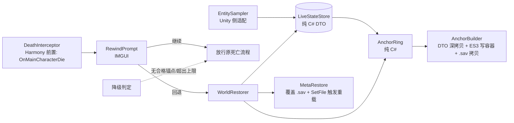

# 死亡回档 Mod（Death Rewind）设计文档

- 日期：2026-10-20（第 3 版：按第 2 轮评审意见修订）
- 目标游戏：《逃离鸭科夫》/ Escape from Duckov，Steam 版 2.3.30，macOS（`Duckov.app`）
- 目标平台：Unity Mono 后端（非 IL2CPP），原生 Mod 加载机制 + Harmony 2.4.1

## 1. 目标

做一个 Mod：**战斗中被击杀时冻结游戏并弹出确认框，选择"回退"则把整个世界状态回滚到约 120 秒前**，而不是接受死亡结算。

成功判据：

1. 玩家在关卡中被击杀 → 死亡链路第二步（`LevelManager.OnMainCharacterDie`）被拦截，游戏冻结，弹出"继续（接受死亡）/ 回退"两个选项。
2. 选择回退 → 玩家复活，血量、位置、背包、装备回到锚点时刻；敌人、战利品箱、门、世界时间也回到锚点时刻；任务/经济/EXP 等元系统通过存档重载机制同步回滚。
3. 恢复过程无崩溃；**回退失败时玩家仍处于死亡态、背包与元系统处于回退前状态**（不出现"半复活"或"进度丢失"）；在拦截前判定不可回退时，游戏表现与原版完全一致。
4. 回退后不足 120 秒再次死亡，仍可再回退一次（更早的锚点）。
5. 单局回退次数不超过 `maxRewinds`（默认 3），达到上限后退化为正常死亡流程。

非目标：

- 不修改游戏本体代码、不做存档格式修改。
- 不做"无限回退"——回退次数由 `maxRewinds` 显式封顶。
- 不做多人/联机相关（游戏本身为单机）。
- 不做关卡重载式的"回到关卡开头"。
- 不回滚死亡瞬间已经触发的表现类副作用（死亡动画、击杀计数播报等），详见 §13 未覆盖清单。

## 2. 术语

| 术语 | 含义 |
|---|---|
| 锚点（Anchor） | 某一时刻的完整世界状态快照，含内存态、容器/背包数据与主存档副本 |
| 锚点网格 | 从关卡开始，每 `anchorInterval` 秒生成一个锚点 |
| 锚点环 | 环形保留最近 `anchorCount` 个锚点 |
| 已消耗锚点 | 曾作为恢复目标的锚点；**在同一关卡内永不再被选中** |
| 回退次数 | 本关卡内已成功执行回退的次数，上限 `maxRewinds` |
| 采样 | 把当前世界实体状态写入"实时状态字典"（非锚点） |
| 冻结 | `Time.timeScale = 0` |

## 3. 已核实的游戏事实

全部来自本地反编译（`TeamSoda.Duckov.Core.dll` 与 `ItemStatsSystem.dll`，用 `ilspycmd` 重建），非猜测。实现时若发现与本文不符，以反编译结果为准并同步修订本文。

| 事实 | 证据 |
|---|---|
| 主存档为 ES3 文件 `Saves/Save_{slot}.sav`，路径由 `SavesSystem.GetFilePath(slot)` 给出（相对 `Application.persistentDataPath`） | `Saves.SavesSystem` |
| 存档只覆盖玩家与元系统（背包/血量/经济/任务/门开关），不含敌人 AI 与战利品生成 | `LevelManager.SaveMainCharacter`、`SetDoorOpenIfSaveData`、游戏侧无世界实体注册表 |
| 容器背包注册表存在 | `LevelManager.LootBoxInventories`（`Dictionary<int, Inventory>`） |
| 背包/物品有现成序列化，且可**原地恢复**：`InventoryData.FromInventory(inv)` / `await InventoryData.LoadIntoInventory(data, inv)`；物品侧 `ItemTreeData.FromItem(item)` / `ItemTreeData.InstantiateAsync(data)` | `ItemStatsSystem.dll` |
| 游戏自带的 `Inventory.Save(key)` / `Item.Save(key)` 会写入**主存档**，因此 Mod 不使用它们，改用自建 ES3 文件 | `Saves.ItemSavesUtilities.Save` → `SavesSystem.Save` |
| 元系统重载机制：`SavesSystem.SetFile(slot)` 会触发 `OnSetFile` 事件；订阅并从存档重载的系统有 `EXPManager`、`QuestManager`、`EconomyManager`、`StockShop`、`PerkTree`、`ItemShortcut`、`NoteIndex`、`GameRulesManager` 等 | `Saves.SavesSystem.SetFile` 与各系统的 `OnSetFile +=` |
| **`LevelManager` 与 `CharacterMainControl` 均未订阅 `OnSetFile`** → 触发重载不会改写玩家的内存态（位置/血量/背包），玩家状态由本 Mod 独占恢复 | 订阅者清单中无此二者 |
| 死亡链路 | `CharacterMainControl.OnDead` → `Health.OnDeadEvent` → `LevelManager.OnMainCharacterDie(DamageInfo)` → `CharacterDieTask`（2.5s 后 `ClosureView` → 失败场景） |
| `OnMainCharacterDie` 是 `private void (DamageInfo)`，以 `mainCharacter.Health.OnDeadEvent.AddListener` 方式注册 | `LevelManager.cs:400,648` |
| `LevelManager.dieTask` 是 `private bool`，作幂等守卫 | `LevelManager.cs:130,650` |
| 死亡会置位多个私有状态 | `LevelManager.dieTask`、`CharacterMainControl.hasHandledDeath`、`Health.isDead`、`RaidUtilities.RaidInfo.dead` |
| `CharacterItem` 是只读属性 `public Item CharacterItem => characterItem;` → 玩家背包只能**原地恢复**，不能整体替换 | `CharacterMainControl.cs:363` |
| `RaidUtilities.CurrentRaid` 每次从存档实时读取（不缓存内存态） | `RaidUtilities.CurrentRaid` 实现 |
| 敌人死亡后 GameObject 被停用并在 0.5s 后销毁 | `Health.Hurt`（`SetActive(false)`）、`Health.DestroyOnDelay`（`DeadDestroyDelay = 0.5f`） |
| 敌人由场景内 Spawner 生成 | `RandomCharacterSpawner`、`WaveCharacterSpawner`、`CharacterSpawnerGroup` 等 |
| `Door.ForceSetClosed(bool closed, bool triggerEvent)`、`Health.SetHealth(float)`、`Health.SetInvincible(bool)`、`TimeOfDayController.Time`（只读 getter）、`Projectile` 类均存在 | 各对应源码文件 |
| `Health.DestroyOnDelay` 是 `private async UniTask`，Harmony 前置补丁可跳过其方法体 | `Health.cs:469` |
| 关卡生命周期事件源：`LevelManager.OnLevelBeginInitializing`、`LevelManager.OnLevelInitialized`、`LevelManager.OnAfterLevelInitialized`、`MultiSceneCore.OnSubSceneLoaded` | `LevelManager.cs`、`MultiSceneCore` |
| 战斗中已有仅含坐标的位置备份（20 条，3 秒间隔） | `PlayerPositionBackupManager`（与本 Mod 无关，不复用） |
| Mod 加载机制 | 扫描 `Duckov.app/Contents/Mods/<Mod>/`，读 `info.ini` 的 `name` 作为命名空间，加载该命名空间下的 `ModBehaviour` 类；Harmony 不内置，需自带 2.4.1 |

## 4. 总体架构



| 单元 | 职责 | 依赖 |
|---|---|---|
| `ModBehaviour` | Mod 入口，装配所有单元；响应关卡生命周期 | 全部 |
| `LevelHooks` | 关卡生命周期适配：订阅 `LevelManager.OnLevelBeginInitializing` / `OnLevelInitialized` / `OnAfterLevelInitialized` 与 `MultiSceneCore.OnSubSceneLoaded`，对外发出"关卡开始/子场景加载/关卡结束"事件 | Unity |
| `RewindClock` | unscaled 时间轴、锚点网格调度、冻结暂停（**纯 C#**） | 无 |
| `EntitySampler` | Unity 侧适配：枚举关卡实体 → 转换为纯 C# DTO 写入 `LiveStateStore`；维护稳定 ID 注册表 | Unity API |
| `LiveStateStore` | `实体键 → DTO` 字典；提供深拷贝出锚点（**纯 C#**） | 无 |
| `AnchorRing` | 环形保存 K 个锚点、按规则选出回退目标、记录已消耗集合与回退次数（**纯 C#**） | 无 |
| `AnchorBuilder` | 锚点时刻生成锚点：DTO 深拷贝 + 容器/背包写自建 ES3 文件 + 主存档文件拷贝 | Unity + ES3 |
| `WorldRestorer` | 差量应用锚点；恢复玩家；元系统存档覆盖与重载 | Unity API + ES3 |
| `DeathInterceptor` | Harmony 前置补丁拦截死亡，冻结、等待裁决、按 bypass 标志放行 | Harmony |
| `EnemyPersistencePatch` | Harmony 前置补丁阻止 `Health.DestroyOnDelay` 销毁被跟踪的敌人 | Harmony |
| `RewindPrompt` | IMGUI 确认面板（鼠标 + 快捷键） | Unity IMGUI |
| `PrivateStateAccessor` | 集中反射访问私有字段（`dieTask`、`hasHandledDeath`、`Health.isDead`、`TimeOfDayController.time` 等），失效时集中报错并降级 | 反射 |
| `ModConfig` | JSON 配置读写 | JSON |

**纯 C# 边界**：`Core` 目录下的 `RewindClock`、`LiveStateStore`、`AnchorRing` 及其 DTO 不引用任何 Unity 或游戏类型。游戏类型（`InventoryData`、`ItemTreeData`、`Vector3`、`Health`…）只出现在 Unity 侧的适配器里：

- 背包/容器内容以**不透明字节串**（ES3 序列化的 `InventoryData`）存进 DTO，Core 只搬运字节，不认识其结构；
- 位置/旋转用 `float` 三元组/四元组，不用 `Vector3`/`Quaternion`。

这样 §11.1 的单测不需要引用 Unity 程序集。

依赖方向单向，无环。

## 5. 快照数据模型

所有锚点数据写入 mod 私有路径 `Saves/ModRewind/`，**不污染主存档**（不使用 `SavesSystem.Save` / `ItemSavesUtilities.Save`，改用自建 `ES3Settings`）。

### 5.1 实体键（自建稳定 ID）

不使用 Unity 的 `GetInstanceID()` 作为身份：对象销毁后 instance ID 会被复用，会把新对象误判成旧实体。

| 实体 | 键 | 分配方式 |
|---|---|---|
| 玩家 | `"player"` | 常量 |
| 敌人 | `"enemy:{n}"` | Mod 自增序号 `n` |
| 容器 | `"loot:{key}"` | `LevelManager.LootBoxInventories` 的 `int` key |
| 门 | `"door:{n}"` | Mod 自增序号 `n` |

`EntitySampler` 维护 `UnityEngine.Object 引用 → 稳定 ID` 的注册表；被跟踪的敌人因 §5.3 的销毁拦截而始终存活，引用不会失效，因此映射稳定。新出现的实体获得新序号，不会与旧锚点里的 ID 冲突。

### 5.2 DTO（纯 C#）

| DTO | 字段 | 说明 |
|---|---|---|
| `PlayerState` | 位置 `float[3]`、旋转 `float[4]`、血量、存活标记、背包 `byte[]`（ES3 序列化的 `InventoryData`） | 背包载荷不透明 |
| `EnemyState` | 位置、旋转、血量、存活标记、AI 目标标识 | AI 目标以稳定 ID 表示 |
| `ContainerState` | 键、容量、锁定格、物品载荷 `byte[]` | 载荷不透明 |
| `DoorState` | `closed` 布尔 | |
| `WorldState` | 世界时间、已探索/天气等可读字段 | 见 §13 未覆盖清单 |

### 5.3 状态字段与恢复动作

| 实体 | 快照内容 | 恢复动作 |
|---|---|---|
| 玩家 | 位置、旋转、`Health.CurrentHealth`、`CharacterItem.Inventory` 的 `InventoryData` | 传送 + `SetHealth` + 背包原地还原（§8.1 阶段 E） |
| 敌人 | 位置、旋转、血量、存活标记、AI 目标 | 见 §5.5 差量表 |
| 容器 | `InventoryData` | `Inventory.DestroyAllContent()` 后 `InventoryData.LoadIntoInventory` 原地还原 |
| 门 | `closed` 布尔 | `Door.ForceSetClosed(closed, triggerEvent:false)` |
| 世界时间 | `TimeOfDayController.Time`（只读 → 经 `PrivateStateAccessor` 写私有字段 `time`） | 写回 |
| 子弹 | 不快照 | 回退时销毁场上所有 `Projectile`（锚点时刻在飞的子弹无法原样复原） |

### 5.4 敌人存活与采样覆盖

敌人死亡后 GameObject 会在 0.5s 后被销毁。为使"复活被击杀的敌人"可行，`EnemyPersistencePatch` 拦截 `Health.DestroyOnDelay`：Mod 启用期间，被采样器跟踪的敌人死亡后**不销毁**，仅停用并留在注册表里。

**采样必须覆盖注册表内的停用敌人**：Unity 的对象枚举（`FindObjectsByType` 等）只返回激活对象，因此活跃枚举仅用于**发现新实体**，已停用敌人的状态更新走注册表遍历。否则 §5.5 的"A 活 / B 死"会退化成"A 无 / B 活"而误销毁本应复活的敌人。

代价：停用对象会累积。缓解：锚点滑出锚点环（年龄超过 `anchorCount × anchorInterval`）时释放并销毁这些停用对象。

### 5.5 敌人差量表

设锚点快照状态为 `A`，回退前实时状态为 `B`：

| 情况 | 动作 |
|---|---|
| `A` 活、`B` 活 | 写回位置/旋转/血量/AI 目标 |
| `A` 活、`B` 死 | 复活：启用 GameObject、`Health.isDead=false`、`SetHealth(锚点血量)`、写回位置、重置 AI 目标为 null 并恢复巡逻 |
| `A` 死、`B` 活 | 移除：停用并从注册表注销（该敌人出生于锚点之后，不应存在） |
| `A` 死、`B` 死 | 无操作 |
| `A` 无、`B` 活 | 移除：销毁（锚点之后新出现的敌人，如波次生成）。**Spawner 自身的生成计数不在快照内**，回退后是否补充由 Spawner 自行决定，Mod 不主动触发（见 §13） |

## 6. 锚点调度与选择规则

### 6.1 参数（默认，可配置）

| 参数 | 默认 | 说明 |
|---|---|---|
| `anchorInterval` | 60 s | 锚点网格间隔 |
| `anchorCount` | 4 | 环形保留的锚点数量 |
| `minRewindAge` | 120 s | 回退目标锚点的最小年龄 |
| `maxRewinds` | 3 | 单关卡内回退次数上限 |
| `sampleInterval` | 0.25 s | 内存采样频率（不落盘） |

### 6.2 时间基准

- 全部使用 **unscaled 时间**（`Time.unscaledTime`），冻结期间继续走。
- **锚点网格推进与锚点年龄使用同一时间基准**；冻结期间二者**同时暂停**（冻结标志同时挂起网格推进与年龄计算），避免恢复后锚点年龄相对网格时间戳错位。
- `RewindClock` 因此提供：`Now`（网格时间，冻结时暂停）、`RawNow`（真实 unscaled 时间，仅用于日志）、`IsFrozen`。

### 6.3 生成

- 网格以关卡开始时刻为原点，每 `anchorInterval` 生成一个锚点，环形保留 `anchorCount` 个。
- 锚点内容：实时状态字典的**内存深拷贝** + 容器/背包的 ES3 写入（`Saves/ModRewind/anchor_{n}.es3`）+ 主存档文件拷贝（`Saves/ModRewind/save_{n}.sav`）。
- 内存深拷贝廉价（每 `sampleInterval` 一次）；ES3 与文件拷贝较重，只在锚点时刻做。
- **冻结期间不生成锚点**（网格暂停），避免把"玩家已死亡"的中间态固化成锚点。

### 6.4 选择规则

死亡时目标锚点 = 同时满足以下条件的锚点中**时间最新**的一个：

1. 年龄 ≥ `minRewindAge`（120 s）
2. **未被用作任何一次恢复目标**（已消耗集合，同关卡内永不复用）
3. 本关卡回退次数 < `maxRewinds`

三者任一不满足 → 无合格锚点 → 放行原死亡流程。

### 6.5 推演（参数 `interval=60`、`count=4`、`minAge=120`、`maxRewinds=3`）

环内 4 个锚点的年龄区间约为 `(0–60] / (60–120] / (120–180] / (180–240]`。

**场景 A：三次死亡落在同一个 60 秒网格窗口内**（回退耗时未跨过网格边界）

| 死亡时机 | 合格锚点 | 结果 |
|---|---|---|
| 第 1 次死亡 | 年龄落在 `(120–180]` 的那个（最新且 ≥120、未消耗） | 回退到约 120–180 s 前 |
| 回退后立刻再死 | 上一锚点已消耗；剩余候选中年龄 ≥120 的只有 `(180–240]` 那个 | 再回退到约 180–240 s 前 |
| 第 3 次死亡 | 环内剩余锚点年龄均 <120 | 无合格锚点 → 退化为接受死亡 |

**场景 B：两次死亡间隔 ≥60 秒**（新锚点进入环，最老锚点被挤出）

| 死亡时机 | 合格锚点 | 结果 |
|---|---|---|
| 第 1 次死亡 | `(120–180]` | 回退成功 |
| 之后 | 环内出现新的未消耗锚点，年龄 ≥120 者仍可能被选中 | 仍可回退，但**总次数受 `maxRewinds` 封顶**，达到 3 次后退化为接受死亡 |

"已消耗集合 + `maxRewinds`"两条共同保证回退次数有限（§1 判据 5）。

### 6.6 回退后的时间轴

恢复不改变关卡起点与网格原点；锚点仍按原网格时间戳标识，年龄按 §6.2 的同一时间基准计算。恢复后 `LiveStateStore` 被锚点状态整体替换，后续采样从该状态继续。

## 7. 死亡拦截与回退时序

```
死亡发生 → Health.OnDeadEvent → LevelManager.OnMainCharacterDie(DamageInfo)
   ├─ 前置补丁命中 且 有合格锚点 且 Mod 未禁用 且 未在拦截中
   │     0. 置重入标志 interceptionActive = true（防止二次进入弹出第二个面板）
   │     1. Time.timeScale = 0（冻结）；RewindClock 收到冻结信号
   │     2. 记录死亡上下文（DamageInfo）
   │     3. 打开 IMGUI 面板，等待选择（采样器暂停写入，网格暂停推进）
   ├─ 玩家选「回退」
   │     4. WorldRestorer 分阶段应用（§8.1 阶段 A–E）
   │     5. 阶段 E 完成 → Time.timeScale = 1，关闭面板，锚点标记已消耗，rewindCount++
   └─ 玩家选「继续」
         6. 置 bypassNext = true、清 interceptionActive
         7. 排队到下一帧：由反射调用 `LevelManager.OnMainCharacterDie(DamageInfo)`
            （bypassNext 使前缀补丁放行），原方法正常执行 → 自行置 `dieTask = true`
            → `CharacterDieTask` → 2.5s 后 `ClosureView` → 失败场景
```

要点：

- 拦截点选 `LevelManager.OnMainCharacterDie`（`private void (DamageInfo)`，前置补丁返回 `false` 阻止原方法）：早于 `CharacterDieTask`，因此 `ClosureView` 与失败场景切换都不会发生，回退不需要重载关卡。
- 放行必须**显式重新调用**原方法：Harmony 前置返回 `false` 后游戏不会二次调用它。调用通过 `PrivateStateAccessor` 反射执行，并在下一帧执行（避免在 UI 回调里同步改动场景状态）。`bypassNext` 保证补丁只放行这一次。
- 原方法被拦截时**不会自行设置 `dieTask`**（方法体被跳过），因此拦截期间 `dieTask` 仍为 `false`；重入由 Mod 自己的 `interceptionActive` 标志防护，放行后由原方法正常设置 `dieTask`。
- 该拦截点位于死亡链路第二步：此时 `Health.isDead` 已置位、玩家 GameObject 已停用、击杀计数等副作用已发生。这些副作用中未被快照覆盖的部分不会回滚（见 §13）。

## 8. 降级与容错

### 8.1 恢复的阶段顺序与失败语义

**不变量 1（玩家终态互斥）**：要么"回退成功且玩家存活"，要么"接受死亡且玩家处于死亡态"。不允许半复活。

**不变量 2（物品与元系统完整性）**：回退失败时，玩家背包与元系统必须保持**回退前**的状态，不得因部分写入而丢失物品或进度。

| 阶段 | 内容 | 失败处理 |
|---|---|---|
| A 校验与准备 | 校验锚点可读、容器载荷可解析；把当前主存档备份到 `Saves/ModRewind/save_backup.sav`；记录玩家背包的 `InventoryData` 内存副本 | 失败 → 放弃回退，走"放行死亡"路径 |
| B 元系统存档 | 写临时文件 → 原子改名覆盖主存档 → `SavesSystem.SetFile(SavesSystem.CurrentSlot)` 触发 `OnSetFile` 重载 | 失败 → 还原备份（`ES3.CacheFile(backup)` + `StoreCachedFile(current)`）→ **再次 `SetFile`** 使内存态回到原值 → 校验 EXP/任务键与备份一致；二次失败 → 记录并降级为"接受死亡"，同时保持备份为当前缓存文件，使游戏后续保存不会写入锚点时刻的元系统值 |
| C 容器背包 | 世界容器的 `DestroyAllContent` + `InventoryData.LoadIntoInventory`（异步） | 失败 → 记录"部分回退"，继续按失败语义处理（玩家仍死亡 → 放行死亡）；容器处于部分还原状态，日志显式记录 |
| D 敌人/门/时间/子弹 | 按 §5.5 差量表恢复 | 同上 |
| E 玩家 | E1 读取回退前玩家状态快照 → E2 传送 + `SetHealth` + 背包原地还原（先 `DestroyAllContent` 再 `LoadIntoInventory`）→ E3 复活标志复位（`hasHandledDeath=false`、`Health.isDead=false`、`SetInvincible(false)`、`gameObject.SetActive(true)`、`RaidUtilities.RaidInfo.dead=false`、`LevelManager.dieTask=false`）→ E4 校验（`Health.CurrentHealth > 0 && !Health.isDead`）→ E5 失败则执行 E6 反向复位 | E3/E4 失败 → E6 反向复位回死亡态 → 放行死亡路径 |

阶段顺序说明：

- **B 不会改写玩家的内存态**：`LevelManager` 与 `CharacterMainControl` 均未订阅 `OnSetFile`（见 §3），玩家位置/血量/背包不受 B 影响，因此玩家状态由 E 独占恢复，无"传送被重载覆盖"的风险。
- **E 是最后一步**：E3 之前的任何失败都不会让玩家复活。
- **E2 的背包原子性**：A 阶段已留存玩家背包的 `InventoryData` 副本；若 E2 的 `LoadIntoInventory` 失败，立即用副本回灌，保证不变量 2。
- **E6 反向复位**：把 E2/E3 已改动的字段（血量、存活标记、GameObject 激活状态、背包）逐项改回回退前的死亡态取值，然后按"放行死亡"路径继续。

### 8.2 其它降级情形

| 情形 | 行为 |
|---|---|
| 无合格锚点（刚进关卡、锚点已耗尽、回退次数达上限、Mod 禁用） | 拦截前判定，直接放行原死亡流程 |
| 锚点生成失败（ES3 写入异常、磁盘错误） | 记录日志，丢弃该锚点，其余锚点不受影响 |
| 场景切换/关卡卸载 | 强制还原 `timeScale`，清空锚点环、已消耗集合、回退计数与实时字典，释放停用的敌人对象 |
| 存档覆盖失败 | 按 §8.1 阶段 B 失败处理 |
| 与其他 Mod 冲突 | `info.ini` 的 `name` 取唯一值 `DeathRewind` |

不可回退的判定发生在拦截前，因此"不能回退"时游戏表现与原版完全一致。

### 8.3 主存档覆盖的原子性

- 路径由 `SavesSystem.GetFilePath(SavesSystem.CurrentSlot)` 解析（相对 `Application.persistentDataPath`），不使用字面量。
- 覆盖前把当前 `Save_{slot}.sav` 备份到 mod 私有目录 `Saves/ModRewind/save_backup.sav`（不放进游戏 Saves 目录，避免被游戏扫描）。
- 覆盖采用"写 `Save_{slot}.sav.tmp` → 原子改名"的顺序，杜绝半写文件。
- 覆盖后调用 `SavesSystem.SetFile(SavesSystem.CurrentSlot)`：它会令 `cached=false`、重新 `CacheFile()`（读取被覆盖后的文件）并触发 `OnSetFile`，元系统据此从存档重载。
- 覆盖或重载失败 → 按 §8.1 阶段 B 的失败处理还原。

## 9. 配置

文件：`Duckov.app/Contents/ModConfig/DeathRewind/config.json`（沿用游戏现有 ModConfig 目录约定）。

| 键 | 默认 | 说明 |
|---|---|---|
| `enabled` | `true` | 总开关 |
| `anchorInterval` | `60` | 锚点间隔（秒） |
| `anchorCount` | `4` | 锚点数量 |
| `minRewindAge` | `120` | 最小回退年龄（秒） |
| `maxRewinds` | `3` | 单关卡内回退次数上限 |
| `sampleInterval` | `0.25` | 内存采样间隔（秒） |
| `promptEnabled` | `true` | `false` 时死亡即自动回退（无面板） |
| `autoRewind` | `false` | 仅测试用：无面板直接回退 |
| `rewindHotkey` | `F9` | 确认回退 |
| `continueHotkey` | `Escape` | 接受死亡 |
| `forceFailPhase` | `""` | 测试注入：填 `A`/`B`/`C`/`D`/`E` 强制该阶段抛异常，用于验证降级语义 |
| `logVerbose` | `false` | 详细日志 |

## 10. 工程结构与构建

```
mod-duckov/
  src/DeathRewind/                 # Mod 本体（netstandard2.1）
    DeathRewind.csproj
    ModBehaviour.cs
    Core/Dto.cs                     # 纯 C# DTO
    Core/{RewindClock,LiveStateStore,AnchorRing}.cs    # 纯 C#，不引用 Unity
    Core/EntitySampler.cs           # Unity 侧适配：枚举实体 → DTO
    Core/AnchorBuilder.cs           # 锚点生成（DTO 深拷贝 + 落盘）
    Core/WorldRestorer.cs           # 差量应用 + 玩家恢复
    Core/MetaRestore.cs             # 存档覆盖与元系统重载
    Harmony/{DeathInterceptor,EnemyPersistencePatch}.cs
    UI/RewindPrompt.cs
    Compat/PrivateStateAccessor.cs
    Compat/LevelHooks.cs
    Config/ModConfig.cs
    info.ini
  tests/DeathRewind.Tests/          # 纯逻辑单测（net8.0，不引用 Unity）
  tools/build.sh                    # 构建 + 部署到 Duckov.app/Contents/Mods/DeathRewind/
  docs/superpowers/specs/           # 本设计文档
```

构建要点：

- 目标框架 `netstandard2.1`（与游戏 Mono 运行时兼容）；Harmony 2.4.1 以 `nuget` 引用并随 Mod 一起打包（游戏不内置 Harmony，且不同版本共存会冲突）。
- 游戏程序集引用指向 `Duckov.app/Contents/Resources/Data/Managed/`：`TeamSoda.Duckov.Core.dll`（游戏逻辑）、`ItemStatsSystem.dll`（`Inventory` / `InventoryData` / `ItemTreeData`）、`UnityEngine*.dll`、`EasySave3.dll`。路径通过 MSBuild 属性 `DuckovManagedDir` 传入，默认指向本机安装路径，可用 `-p:DuckovManagedDir=...` 覆盖。
- `Core` 下的纯 C# 文件不得 `using` 任何 Unity / 游戏命名空间（由 CI 脚本 `tools/check-core-purity.sh` 静态检查 `using` 列表）。
- 部署：`tools/build.sh` 构建后把 `DeathRewind.dll`、`info.ini`、`preview.png`、Harmony 依赖复制到 `Duckov.app/Contents/Mods/DeathRewind/`。
- `info.ini` 的 `name=DeathRewind`，对应命名空间下必须有 `ModBehaviour` 类。

## 11. 验证策略

### 11.1 纯逻辑单测（`tests/DeathRewind.Tests`，net8.0，不引用 Unity）

- 锚点选择规则：年龄门槛、已消耗集合排除（**任何一次**用过的锚点都不再合格）、环耗尽返回空、`maxRewinds` 封顶。
- 已消耗集合 + 滚动网格下，回退次数不超过 `maxRewinds`（含"两次死亡间隔 ≥60 秒"的场景）。
- `LiveStateStore` 深拷贝的隔离性（改副本不影响原）。
- `AnchorRing` 的环形保留与滑出释放。
- 网格生成节奏：冻结期间不生成锚点；冻结期间锚点年龄不推进（§6.2）。

### 11.2 构建与加载

构建 → 部署 → 启动游戏 → 读 Unity `Player.log`（macOS 默认 `~/Library/Logs/Company/TeamSoda/Duckov/Player.log`）确认：Mod 加载成功、锚点按 60 秒节奏生成、容器与存档文件落盘、无异常堆栈。

### 11.3 死亡流程（真实游戏内验证）

用 Frida 附加到 Duckov 进程，对主角色造成致命伤害触发死亡。回退日志必须输出可观测字段：

```
[DeathRewind] intercept at gridTime=<秒> dmgInfo=<来源>
[DeathRewind] anchor selected id=<n> anchorGridTime=<秒> age=<秒> rewindNo=<序号>
[DeathRewind] restore phase=<A|B|C|D|E> result=<ok|failed>
[DeathRewind] restore player hp=<值> pos=<x,y,z> bagItems=<数> raidDead=false
[DeathRewind] world diff enemies=<活/死变化数> doorsChanged=<数> containersChanged=<数> timeRestored=<值>
[DeathRewind] uncovered=<逗号分隔的未覆盖项>
```

验证步骤与期望：

1. **拦截**：致死 → 日志出现 `intercept`，`timeScale == 0`，面板可见。
2. **回退成功**：按回退快捷键 → 出现 `anchor selected`（含 `anchorGridTime` 与 `age`）；`restore phase=E result=ok`；玩家存活（`hp>0`）、位置/血量/背包物品数等于锚点值；`world diff` 中敌人、门、容器、时间均显示已还原。
3. **再次回退**：立刻再次致死 → 再次出现 `anchor selected`，其 `id` 与第 2 步不同，且 `age` 大于第 2 步（更早的锚点）。
4. **耗尽降级**：在**同一网格窗口内**第三次致死 → 不出现 `anchor selected`，日志出现 `no eligible anchor`，游戏走正常死亡流程（失败场景加载）。若因回退耗时跨过网格边界导致未耗尽，则以 `rewindNo` 与 `maxRewinds` 为准：允许继续回退，直到 `rewindNo == maxRewinds` 后必然降级。
5. **失败降级**：把 `forceFailPhase` 设为 `C`（容器恢复阶段）后致死并回退 → 日志出现 `restore phase=C result=failed`，随后玩家**仍处于死亡态**（`hp==0`）、背包物品数等于回退前、元系统 EXP 与任务键等于回退前；游戏正常进入失败场景。再用 `forceFailPhase=E` 重复一次，确认 E6 反向复位生效（玩家仍死亡）。
6. **世界状态比对**：回退前后分别记录 3 个敌人的存活状态、2 个门的开合、2 个容器的物品数、`TimeOfDayController.Time`，与锚点日志中的值逐项比对。
7. **存档一致性**：回退前后对比 `Save_{slot}.sav` 的 `EXP`、任务进度键，确认回到锚点值且无重复领奖。

## 12. 风险与缓解

| 风险 | 影响 | 缓解 |
|---|---|---|
| 敌人停用对象累积 | 内存/性能 | 锚点滑出锚点环时释放并销毁 |
| `InventoryData.LoadIntoInventory` 是异步 | 恢复时序 | 恢复流程整体异步化，`timeScale` 保持 0 直到恢复完成；加超时兜底（超时按 §8.1 失败处理） |
| 私有字段复位依赖反射 | 游戏更新后失效 | 集中在 `PrivateStateAccessor`，失效时集中报错并降级为"接受死亡" |
| 覆盖主存档与游戏自身保存竞争 | 存档损坏 | 备份 + 临时文件原子改名；失败自动还原备份并二次重载 |
| `SetFile` 触发全量 `OnSetFile` 重载 | 副作用（UI 刷新、规则重载） | 这是游戏自身回档路径的同一机制；重载后校验关键系统（EXP、任务） |
| 锚点间隔过小 | IO 压力 | 采样（内存）与落盘（ES3/文件）分离，落盘只在锚点时刻 |
| 世界时间/子弹/迷雾等状态不完整 | 回退后局部不一致 | 已知未覆盖项在恢复日志中显式列出（§13），避免"静默不一致" |
| 回退耗时跨过网格边界 | 锚点年龄与推演不符 | 锚点年龄以 `anchorGridTime` 为准计算并写入日志；测试以运行时网格日志比对而非固定区间 |

## 13. 未覆盖清单（显式声明）

以下状态**不参与快照**，回退后可能与锚点时刻不一致：

- 死亡瞬间已触发的表现类副作用：死亡动画、击杀计数播报、成就/统计的即时写入（成就与统计走 `OnCollectSaveData`，会在下次存档时被覆盖）。
- `FogOfWarManager` 的迷雾状态（其 `FogOfWarWorld` 不在 `TeamSoda.Duckov.Core.dll` 内，无可用的读写接口）。
- 在飞子弹（回退时统一销毁）。
- 敌人 Spawner 自身的生成计数与计时（`RandomCharacterSpawner` / `WaveCharacterSpawner` 等）→ 回退后敌人数量可能永久减少，由 Spawner 自行决定是否补充，Mod 不主动触发生成。
- 未订阅 `SavesSystem.OnSetFile` 的子系统（若有）不会随元系统回滚而重载。
- 玩家与敌人的动画/动作状态机、Buff 的部分瞬时状态。
- 未在锚点环内、且已被释放的停用敌人对象。

上述项在恢复日志中以 `uncovered=` 字段列出，便于排查。
